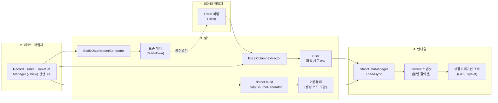

# 1. 소개

## Sdp 소개

**StaticDataPipeline (Sdp)** 은 Excel 에 정의된 정적 데이터를 C# Record 로 로드하고, 검증된 상태의 불변 컬렉션을 메모리에 올려 빠르게 조회하도록 도와주는 파이프라인 라이브러리입니다.

게임 서버와 클라이언트, 시뮬레이션 도구처럼 "한 번 로드해 두고 읽기만 하는" 데이터에 적합합니다.

   

## 주요 장점

#### Excel 작업과 코드 작업의 병렬화
데이터 구조가 합의된 시점부터 데이터 작업자와 레코드 작업자가 서로를 기다리지 않고 독립적으로 진행할 수 있습니다.

 

#### 선언적 스키마 정의
타입, 컬럼, 외래 키 관계를 C# Record 와 Attribute 로 직접 선언합니다. 매핑 코드는 소스 제너레이터가 컴파일 시점에 생성하므로, 별도 매핑 코드 없이 선언만으로 강타입 객체에 로드됩니다.

 

#### 런타임 리플렉션 없음
CSV 매핑, 테이블 로드, 외래 키 검증, 뷰 빌드가 모두 컴파일된 코드로 존재합니다. IL2CPP 같은 AOT 환경과 코드 스트리핑에서도 그대로 동작하고, 선언의 결함은 실행이 아니라 빌드에서 드러납니다 (자세한 내용은 [5.5](./05-advanced/05-source-generator.md)).

 

#### 사전 유효성 검사
외래 키 무결성, null 표현 처리, 필수 Attribute 누락 같은 검사를 컴파일 시점 진단, 추출 단계, 로드 단계에서 자동으로 수행합니다. 잘못된 데이터가 운영 환경까지 흘러가는 일을 줄일 수 있습니다.

 

#### 타입 브랜딩 지원
단일 파라미터 record 나 enum 으로 의미가 다른 ID 들을 별개 타입으로 취급할 수 있습니다. 잘못된 ID 대입은 빌드 단계에서 드러나고, Excel 시트에서는 평범한 한 컬럼으로 보입니다 (자세한 내용은 [5.3](./05-advanced/03-type-branding.md)).

 

#### 로드된 데이터의 불변성 보장
Record 가 불변이고 컬렉션도 `ImmutableArray`, `FrozenSet`, `FrozenDictionary` 같은 불변 타입에 적재됩니다. 로드 이후 데이터가 의도치 않게 바뀌는 경로 자체가 막혀 있습니다.

   

## 네 자리에서 쓰인다

Sdp 는 서로 독립된 네 자리에서 쓰입니다. 사람이 만드는 것은 **Excel** (데이터 작업자) 과 **C# 선언** (레코드 작업자) 둘뿐이고, 빌드가 그 둘을 이어 런타임이 쓸 **CSV** 와 **어셈블리** 를 만듭니다.

|자리|하는 사람|입력|사용하는 Sdp|산출물|
|-|-|-|-|-|
|**1. 데이터 작업자**|기획자 등 Excel 담당|합의된 컬럼 구성, 표준 헤더|표준 헤더 생성기의 결과 (Markdown). 로컬 검증을 원하면 `ExcelColumnExtractor`|Excel 파일|
|**2. 레코드 작업자**|C# 개발자|합의된 컬럼 구성|`Sdp.dll` 의 Attribute · `StaticDataTable` · `StaticDataManager` · `StaticDataView`, 분석기로 참조한 `Sdp.SourceGenerator` (빌드마다 `SDPxxxx` 진단)|Record · Table · TableSet · Manager (· View) 선언|
|**3. 빌드**|CI 또는 로컬 bat|Excel 폴더, Record `.cs` 폴더, 소비자 프로젝트|`StaticDataHeaderGenerator`, `ExcelColumnExtractor`, `Sdp.SourceGenerator` (컴파일러 안에서 실행)|표준 헤더 Markdown, CSV, 생성 코드가 포함된 어셈블리|
|**4. 런타임**|애플리케이션|CSV 폴더, 어셈블리|`Sdp.dll` 의 `LoadAsync` 와 인덱스, 어셈블리 안의 생성 코드|메모리에 올라간 `Current` 스냅샷|

두 작업자는 서로의 산출물을 직접 읽지 않습니다. 레코드 작업자가 Excel 을 열 일도, 데이터 작업자가 `.cs` 를 볼 일도 없습니다. 두 자리가 만나는 곳은 빌드의 두 도구뿐이며, 표준 헤더가 C# → Excel 방향을, 추출기가 Excel + C# → CSV 방향을 이어 줍니다. 런타임에는 CSV 와 어셈블리, `Sdp.dll` 만 남습니다.

검사도 네 자리에 나뉘어 있습니다. 선언의 결함은 레코드 작업자의 IDE 와 빌드에서 (`SDPxxxx`), 셀 값의 결함은 빌드의 추출기에서, 외래 키 값과 뷰 빌드는 런타임 로드에서 걸립니다. 어느 검사가 어디서 도는지는 [5.4 유효성 검사 개요](./05-advanced/04-validation.md) 에 표로 정리되어 있습니다.

   

## 일단 한번 돌려 보고 싶다면

가장 빠른 길은 [빠른 시작](./quickstart.md) 한 페이지를 끝까지 따라가 보는 것입니다. 위 네 자리를 한 번씩 거치는 7단계 — Record → Table → Manager → 빌드 → Excel → 추출 → 로드·조회 — 의 골격만 다루며, FK 와 뷰는 빠져 있어 5분이면 끝납니다. 본격적인 사용은 그 다음에 [3.1](./03-usage/01-record-to-excel.md) 부터 따라가면 됩니다.

---

[목차](./README.md) | [다음: 2. 설치 →](./02-installation.md)
