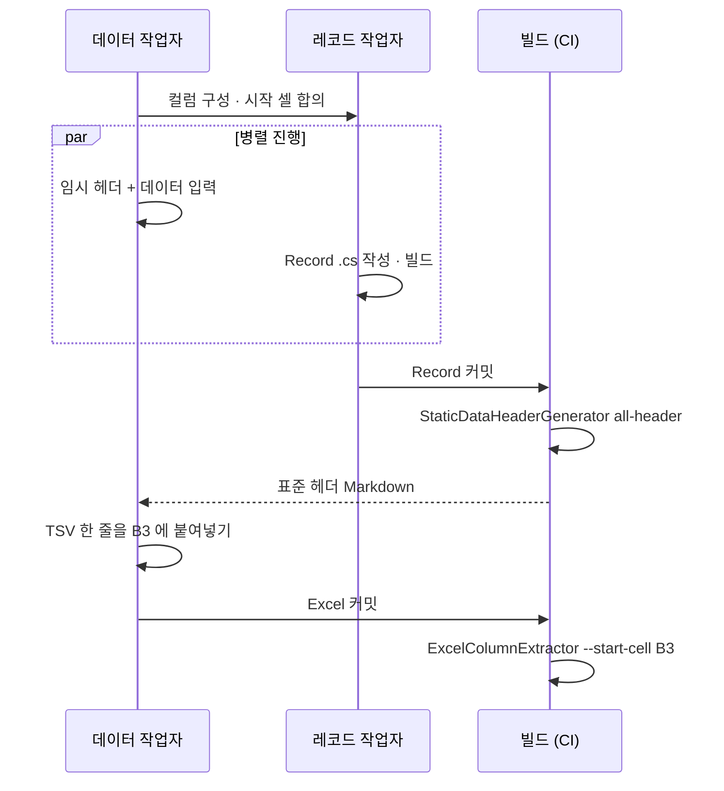

# 3.2 표준 헤더 생성기

> 이 챕터는 **데이터 작업자** 를 위한 안내입니다. [3.1](./01-record-to-excel.md) 에서 본 객체의 배열 예제처럼 헤더가 한 행으로 길어질 때, 손으로 맞추지 않고 자동으로 채우는 방법을 다룹니다.

## 왜 필요한가

[3.1](./01-record-to-excel.md) 에서 다룬 두 종류의 시트를 다시 떠올려 봅시다.

`ItemRecord` 같은 단순한 시트는 헤더가 짧고, 손으로 적어도 어렵지 않습니다.

```csharp
[StaticDataRecord("GameItems", "Items")]
public sealed partial record ItemRecord(
    int Id,
    string Name,
    int Price,
    ItemCategory Category);
```

|       | **A**  | **B**    | **C**   | **D**        |
|-------|--------|----------|---------|--------------|
| **1** | Id     | Name     | Price   | Category     |
| **2** | 1      | Potion   | 100     | Consumable   |

반면 학생 한 명이 여러 과목의 성적을 가지는 시트는 표준 헤더가 다음처럼 길어졌습니다.

|       | **A** | **B**   | **C**                 | **D**               | **E**                 | **F**               | **G**                 | **H**               |
|-------|-------|---------|-----------------------|---------------------|-----------------------|---------------------|-----------------------|---------------------|
| **1** | Id    | Name    | Subjects[0].Subject   | Subjects[0].Score   | Subjects[1].Subject   | Subjects[1].Score   | Subjects[2].Subject   | Subjects[2].Score   |
| **2** | 1     | Alice   | Math                  | 90                  | English               | 85                  | Science               | 88                  |

이 시트에 대응하는 Record 는 다음과 같습니다.

```csharp
[StaticDataRecord("StudentReport", "Grades")]
public sealed partial record StudentRecord(
    int Id,
    string Name,
    [Length(3)] ImmutableArray<SubjectScore> Subjects);

public sealed record SubjectScore(string Subject, int Score);
```

`SubjectScore` 의 필드를 바꾸거나 반복 횟수를 조정하면 헤더 줄을 처음부터 다시 맞춰야 합니다. 시트가 여러 개 있다면 그 작업이 곱절로 늘어납니다. **`StaticDataHeaderGenerator`** 는 Record `.cs` 파일을 입력으로 받아 위와 같은 헤더 한 줄을 자동으로 출력해 주는 CLI 도구입니다.

</br></br></br>

## 실행해 보기

앞에서 정의한 `StudentRecord` 를 그대로 사용합니다. Record `.cs` 가 `./Records` 폴더에 있다면 다음 한 줄로 표준 헤더가 담긴 Markdown 파일을 받아낼 수 있습니다.

```bash
StaticDataHeaderGenerator.exe header ^
  --record-path ./Records ^
  --record-name StudentRecord ^
  --output-file ./Headers/Student.md
```

`./Headers/Student.md` 파일이 생기고, 그 안에는 다음과 같은 Markdown 문서가 들어 있습니다.

````markdown
# StaticDataHeaderGenerator Results

## StudentRecord
- Excel File: `StudentReport.xlsx`
- Sheet Name: `Grades`

### Headers (List)
- Id
- Name
- Subjects[0].Subject
- Subjects[0].Score
- Subjects[1].Subject
- Subjects[1].Score
- Subjects[2].Subject
- Subjects[2].Score

### Headers (TSV)
```
Id	Name	Subjects[0].Subject	Subjects[0].Score	Subjects[1].Subject	Subjects[1].Score	Subjects[2].Subject	Subjects[2].Score
```
````

Excel 에 실제로 붙여넣을 줄은 **`### Headers (TSV)` 코드 블록 안의 한 줄** 입니다. 옵션, 출력 형식 전체는 [4.1](../04-cli-tools/01-header-generator.md) 에 정리되어 있습니다.

폴더 안의 모든 `[StaticDataRecord]` Record 를 한꺼번에 뽑는 `all-header` 명령도 있습니다. 한 Markdown 파일 안에 시트별 섹션이 차례로 정리됩니다. 전체 명령 형태와 옵션은 [4.1 StaticDataHeaderGenerator](../04-cli-tools/01-header-generator.md) 에 정리되어 있습니다.

</br></br></br>

## Excel 에 붙여넣기

위 Markdown 파일에서 자기 시트에 해당하는 줄을 Excel 헤더에 적용해 봅니다. 붙여넣기 전 시트에는 [3.1](./01-record-to-excel.md) 에서처럼 데이터 작업자가 알아보기 쉽게 적어 둔 임시 헤더와 데이터가 이미 들어가 있다고 합시다.

|       | **A** | **B**   | **C**       | **D**       | **E**       | **F**       | **G**       | **H**       |
|-------|-------|---------|-------------|-------------|-------------|-------------|-------------|-------------|
| **1** | Id    | Name    | 수학과목     | 수학점수     | 영어과목     | 영어점수     | 과학과목     | 과학점수     |
| **2** | 1     | Alice   | Math        | 90          | English     | 85          | Science     | 88          |
| **3** | 2     | Bob     | Math        | 70          | English     | 95          | Science     | 75          |

1. `Student.md` 를 VS Code, 메모장, 브라우저 렌더링 등 편한 방식으로 엽니다.
2. 해당 Record 섹션의 **`### Headers (TSV)` 아래 코드 블록 안의 한 줄** 만 정확히 선택해서 복사합니다 (` ``` ` 표시 줄은 포함하지 않습니다). 보통 그 줄에서 `Home → Shift+End → Ctrl+C` 가 안전합니다.
3. Excel 의 `StudentReport.xlsx` 파일을 열고 `Grades` 시트로 갑니다.
4. 헤더가 시작될 셀 (예: `A1`) 을 한 번 클릭합니다. 이 한 셀만 선택한 상태여야 합니다.
5. `Ctrl + V` 로 붙여넣습니다.

탭 구분자가 자연스럽게 한 칸씩 다른 셀로 들어가므로, 한 번의 붙여넣기로 1행의 임시 헤더가 표준 헤더로 교체됩니다.

|       | **A** | **B**   | **C**                 | **D**               | **E**                 | **F**               | **G**                 | **H**               |
|-------|-------|---------|-----------------------|---------------------|-----------------------|---------------------|-----------------------|---------------------|
| **1** | Id    | Name    | Subjects[0].Subject   | Subjects[0].Score   | Subjects[1].Subject   | Subjects[1].Score   | Subjects[2].Subject   | Subjects[2].Score   |
| **2** | 1     | Alice   | Math                  | 90                  | English               | 85                  | Science               | 88                  |
| **3** | 2     | Bob     | Math                  | 70                  | English               | 95                  | Science               | 75                  |

임시 헤더 (`수학과목`, `수학점수` …) 와 표준 헤더 (`Subjects[0].Subject` …) 가 얼마나 다른지는 두 표의 1행을 비교하면 분명합니다. 데이터 행은 그대로 두고 헤더 한 줄만 바뀌었습니다.

</br></br></br>

## 권장 작업 흐름

표준 헤더가 확정되기 전에도 데이터 입력을 멈출 필요는 없습니다. **임시 헤더** 를 한 행 위에 두면 Record 정의와 데이터 입력을 병렬로 진행할 수 있습니다.

추출기 옵션을 `--start-cell B3` 으로 합의했다고 합시다. 이때 시트 구성은 다음과 같이 잡습니다.

|       | **A**       | **B**       | **C**       | **D**       |
|-------|-------------|-------------|-------------|-------------|
| **1** | (자유)       | (자유)       | (자유)       | (자유)       |
| **2** |             | 임시 헤더    | 임시 헤더    | 임시 헤더    |
| **3** |             | 표준 헤더    | 표준 헤더    | 표준 헤더    |
| **4** |             | 데이터       | 데이터       | 데이터       |

- `A` 열과 `1`, `2` 행은 추출기가 읽지 않는 자유 영역입니다. **이 테이블에 대한 일러두기, 변경 이력, 담당자 메모** 같은 시트 안에서만 의미 있는 정보를 적어 두기에 좋은 자리입니다.
- `B2` 행에는 데이터 작업자가 알아보기 쉬운 임시 이름을 적어 둡니다 (예: "ID", "이름", "수학 점수").
- `B3` 행은 표준 헤더 자리입니다. Record 정의가 끝나기 전에는 비워 두고, `StaticDataHeaderGenerator` 결과 Markdown 의 `### Headers (TSV)` 코드 블록 안 한 줄을 그대로 붙여넣습니다.
- `B4` 부터 데이터를 채웁니다.

데이터 작업자 입장의 흐름은 다음과 같이 흘러갑니다.

1. 레코드 작업자와 컬럼 구성, 시작 셀 (`B3`) 을 합의합니다. 이 시점에는 Record `.cs` 가 아직 미완성이어도 됩니다.
2. `B2` 에 임시 헤더를 적고, `B4` 부터 데이터를 입력해 나갑니다.
3. 레코드 작업자가 Record 를 확정하면 `StaticDataHeaderGenerator` 를 돌려 표준 헤더를 받아옵니다.
4. 그 결과를 `B3` 에 붙여넣습니다. 임시 헤더는 그대로 둬도 되고, 깔끔하게 지워도 됩니다.
5. 이후 추출은 `ExcelColumnExtractor --start-cell B3` 으로 진행됩니다 (CI 에서 자동 실행을 권장).



### 표준 헤더를 받는 경로

3번에서 생성기를 **누가** 돌리는지는 팀마다 다를 수 있지만, 데이터 작업자가 실행 파일과 `.cs` 폴더를 직접 다루지 않아도 되는 다음 방식을 권장합니다.

- 레코드 작업자 (또는 CI) 가 Record 가 바뀔 때마다 `all-header` 로 전체 헤더를 한 Markdown 파일에 뽑아 정해진 자리에 올려 둡니다 ([4.1 — 권장 워크플로우](../04-cli-tools/01-header-generator.md#권장-워크플로우)).
- 데이터 작업자는 그 파일에서 자기 시트의 섹션만 찾아 붙여넣습니다.
- 컬럼이 추가되거나 이름이 바뀌거나 반복 횟수 (`[Length]`) 가 달라지면 헤더 줄도 바뀝니다. 레코드 작업자가 변경을 알리면 같은 자리에서 갱신된 Markdown 을 다시 받아 붙여넣습니다.

</br></br></br>

## 옵션 전체와 자동화

명령의 두 형태 (`header` / `all-header`), 옵션 전체, bat 자동화 예제는 [4.1 StaticDataHeaderGenerator](../04-cli-tools/01-header-generator.md) 에 정리되어 있습니다.

---

[← 이전: 3.1 Excel 작업하기](./01-record-to-excel.md) | [목차](../README.md) | [다음: 3.3 첫 Record 정의하기 →](./03-first-record.md)
