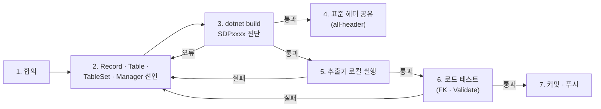

# 3.3 첫 Record 정의하기

> 여기서부터는 **레코드 작업자** 관점으로 전환됩니다. 데이터 작업자 관점의 Excel 작성은 [3.1](./01-record-to-excel.md), [3.2](./02-header-generator.md) 에서 다루었고, 이번 챕터부터는 C# 쪽에서 Record 와 Table, Manager 를 어떻게 짜는지 봅니다.

이미 채워진 시트가 있고, 거기에 맞는 C# Record 를 처음 작성하는 시나리오입니다. 예시 시트는 다음과 같다고 합시다.

|       | **A**  | **B**    | **C**       | **D**   | **E**        |
|-------|--------|----------|-------------|---------|--------------|
| **1** | Id     | Name     | Memo        | Cost    | Category     |
| **2** | 1      | Potion   | 회복 아이템   | 100     | Consumable   |
| **3** | 2      | Sword    | 기본 검      | 5000    | Weapon       |
| **4** | 3      | Shield   | 기본 방패    | 4000    | Armor        |

`Memo` 는 데이터 작업자의 참고용 컬럼입니다. C# 쪽에서는 사용하지 않습니다. **Record 가 요구하지 않은 컬럼은 CSV 로 추출되지 않습니다** — 아래 결과 CSV 에서 `Memo` 가 빠진다는 점을 미리 봐 두세요.

데이터 작업자는 가격을 `Cost` 라고 부르고 있지만, C# 코드에서는 `Price` 라는 이름을 쓰고 싶다고 합시다. 이 경우 `[ColumnName]` 으로 시트 헤더와 파라미터 이름을 분리해서 매핑할 수 있습니다.

## Record 정의

```csharp
using Sdp.Attributes;

public enum ItemCategory
{
    Consumable,
    Weapon,
    Armor,
}

[StaticDataRecord("GameItems", "Items")]
public sealed partial record ItemRecord(
    int Id,
    string Name,
    [ColumnName("Cost")][Range(0, 1_000_000)] int Price,
    ItemCategory Category);
```

짧지만 필요한 정보가 모두 들어 있습니다. 하나씩 보겠습니다.

### `partial`

Record 는 `partial` 로 선언합니다. 소스 제너레이터가 같은 타입에 CSV 한 행을 Record 로 바꾸는 코드를 생성해 넣기 때문입니다. 빠뜨리면 빌드 시 `SDP0001` 오류가 납니다. Record 가 다른 타입 안에 중첩되어 있다면 바깥 타입도 `partial` 이어야 합니다.

### `[StaticDataRecord("GameItems", "Items")]`

이 Record 가 어느 Excel 파일의 어느 시트에 대응하는지 지정합니다. 첫 번째 인자가 **Excel 파일 이름** (확장자 제외), 두 번째 인자가 **시트 이름** 입니다. 두 가지 용도로 쓰입니다.

- `ExcelColumnExtractor` 가 CSV 를 뽑을 때 대상 파일과 시트를 찾는다.
- 추출 결과 CSV 의 파일 이름 — `{파일}.{시트}.csv` — 에 사용된다. 위 예제에서는 `GameItems.Items.csv`.

### `int Id`, `string Name`

특별한 Attribute 가 없으면 컬럼 이름은 **파라미터 이름과 동일** 합니다. 시트의 헤더에 `Id`, `Name` 컬럼이 있어야 매핑됩니다.

### `[ColumnName("Cost")][Range(0, 1_000_000)] int Price`

`[ColumnName(name)]` 은 Excel 헤더 이름과 C# 파라미터 이름이 다를 때 그 매핑을 알려 줍니다. 위 시트의 헤더는 `Cost` 이고 Record 파라미터는 `Price` 이므로, `[ColumnName("Cost")]` 로 둘을 연결합니다. 헤더와 파라미터 이름이 같으면 굳이 적지 않아도 됩니다.

`[Range(min, max)]` 는 값이 지정된 범위 안에 있는지 검사합니다. 범위를 벗어난 값은 추출 단계와 런타임 로드 양쪽에서 걸러집니다.

> `1_000_000` 은 C# 의 [숫자 리터럴 구분자](https://learn.microsoft.com/dotnet/csharp/language-reference/builtin-types/integral-numeric-types#integer-literals) 표기로, `1000000` 과 같은 값입니다. 가독성 보조용일 뿐이므로 `[Range(0, 1000000)]` 로 적어도 됩니다.

### `ItemCategory Category`

`enum` 은 **문자열로 매칭** 됩니다. CSV 셀에 `Consumable` 이라고 적혀 있어야 `ItemCategory.Consumable` 로 파싱됩니다. 추출기는 enum 멤버 이름만 허용합니다. 로드 시 생성된 매퍼는 멤버 이름과 멤버의 정수 값 문자열(예: `1`) 을 모두 받습니다. 대소문자는 구분합니다. `[Key]` 가 붙은 enum 은 추출기가 멤버 검사를 건너뛰고, 로드 시에도 정의되지 않은 값이 캐스트로 통과합니다.

</br></br></br>

## 추출 실행하기

Record 정의가 끝나면 **`ExcelColumnExtractor`** 로 시트에서 CSV 를 뽑습니다. 추출기는 Record 폴더, Excel 폴더, 출력 폴더 세 곳만 지정하면 그 안의 모든 Record/Excel 을 알아서 매칭해 처리합니다.

```bash
ExcelColumnExtractor.exe ^
  --record-path ./Records ^
  --excel-path ./Excels ^
  --output-path ./Csv
```

- `--record-path` — `[StaticDataRecord]` 가 붙은 Record `.cs` 파일들이 있는 폴더
- `--excel-path` — Excel 파일들이 있는 폴더
- `--output-path` — 결과 CSV 가 만들어질 폴더

시작 셀 위치가 `A1` 이 아니라면 `--start-cell` 로 알려 줍니다. 빌드 버전별 산출물 분리 (`--version`), 로그 설정 같은 옵션 전체는 [4.2 ExcelColumnExtractor](../04-cli-tools/02-column-extractor.md) 에 정리되어 있습니다.

</br></br>

### 결과 CSV

위 Record 가 요구하는 컬럼만 추려서 `GameItems.Items.csv` 가 만들어집니다.

```
Id,Name,Cost,Category
1,Potion,100,Consumable
2,Sword,5000,Weapon
3,Shield,4000,Armor
```

CSV 파일 이름은 **`{파일}.{시트}.csv`** 규칙입니다. `GameItems.xlsx` 의 `Items` 시트 → `GameItems.Items.csv`.

CSV 의 헤더는 시트의 원본 헤더(`Cost`) 를 그대로 유지합니다. 로드 단계에서 `[ColumnName("Cost")]` 가 `Cost` 컬럼을 Record 의 `Price` 파라미터로 연결해 줍니다.

로드 시 CSV 헤더는 다음 규칙으로 매칭됩니다. 헤더 이름은 대소문자를 구분하고, 컬럼 순서는 상관없으며, 빈 헤더 셀은 무시됩니다. 같은 헤더가 둘 이상이거나 Record 가 요구하는 헤더가 없으면 예외가 납니다. 빈 줄은 건너뛰고, 헤더보다 필드가 적은 행은 오류입니다.

원본 시트에 있던 `Memo` 는 Record 가 요구하지 않으므로 CSV 에 포함되지 않습니다. 같은 Excel 을 서버, 클라이언트, 툴이 각자 다른 Record 정의로 소비할 수 있는 이유가 여기에 있습니다.

</br></br>

### 추출 단계에서 검증되는 것

추출기는 단순히 셀을 옮겨 적기만 하지 않고 다음을 함께 검사합니다.

- **Record 측 스키마 자체의 결함** — 추출기가 Roslyn 으로 `.cs` 파일을 파싱해 잘못된 Attribute 사용 등을 잡습니다. 같은 결함 대부분은 Record 를 포함한 프로젝트를 빌드할 때 소스 제너레이터 진단 (`SDP00xx`) 으로도 드러납니다.
- **Record 가 요구하는 컬럼이 시트에 있는지** — 없으면 실패하고 어느 시트의 어느 컬럼인지 보고합니다. Record 의 헤더 두 개가 같은 시트 컬럼을 가리켜도 (두 파라미터에 같은 `[ColumnName]` 을 붙인 경우 등) 실패합니다.
- **셀 값이 타입과 호환되는지** — 숫자 컬럼에 문자가 들어 있거나, 정해진 길이를 벗어난 컬렉션, `[Range]` / `[RegularExpression]` / 포맷 위반 등을 추출 시점에 검사합니다.
- **Primary Key 중복** — `[Key]` 가 붙은 컬럼의 값이 시트 안에서 중복되면 실패합니다. `[Key]` 는 필수가 아니며, PK 가 없는 데이터 테이블도 허용합니다 (이 경우 중복 검사 자체가 생략됩니다).

외래 키 (`[ForeignKey]`, `[SwitchForeignKey]`) 무결성은 추출 단계가 아니라 런타임 `LoadAsync` 에서 검증됩니다 ([3.6](./06-foreign-keys.md)).

</br></br></br>

## 권장 작업 흐름

레코드 작업자의 한 사이클은 다음과 같습니다. 선언 하나를 추가하거나 바꿀 때마다 같은 순서를 반복합니다.



1. **합의** — Record `.cs` 와 Excel 시트의 컬럼 구성, 파일·시트 이름, 시작 셀 위치를 데이터 작업자와 합의합니다 ([3.1 — 시작하기 전에 합의할 것](./01-record-to-excel.md#시작하기-전에-합의할-것)).
2. **선언** — Record 를 쓰고, 그에 대응하는 Table ([3.4](./04-static-data-table.md)) 을 만들고, TableSet 과 Manager ([3.5](./05-static-data-manager.md)) 에 등록합니다. TableSet 의 파라미터가 Table 인스턴스이므로 순서는 Record → Table → TableSet → Manager 입니다. 네 가지는 모두 같은 프로젝트 (컴파일레이션) 에 있어야 합니다 ([3.5](./05-static-data-manager.md#manager-와-tableset-정의)).
3. **빌드** — `dotnet build` 가 첫 검증 게이트입니다. `partial` 누락, FK 타겟 오타, 주 생성자 개수 같은 선언 결함은 여기서 `SDPxxxx` 오류로 멈춥니다 ([5.6](../05-advanced/06-diagnostics.md)). Excel 이나 CSV 가 없어도 통과해야 합니다.
4. **표준 헤더 공유** — 헤더가 길어지는 시트가 있다면 `StaticDataHeaderGenerator all-header` 결과를 데이터 작업자가 받는 자리에 올립니다 ([4.1](../04-cli-tools/01-header-generator.md#권장-워크플로우)). CI 가 대신 돌려 주는 구성이 가장 편합니다.
5. **추출기 로컬 실행** — 현재 시트에서 내 Record 가 추출되는지 확인합니다. 헤더 누락과 셀 값 결함은 여기서 드러납니다.
6. **로드 테스트** — 추출된 CSV 로 `LoadAsync` 를 한 번 돌리는 테스트를 둡니다. 추출기가 검사하지 않는 FK 값 무결성과 `Validate` 교차 검증이 머지 전에 걸리는 유일한 자리입니다 ([3.6 — FK 오류를 머지 전에 잡으려면](./06-foreign-keys.md#fk-오류를-머지-전에-잡으려면)).
7. **커밋·푸시** — CI 가 3, 5, 6 을 다시 실행하도록 스텝을 둡니다 ([4.2](../04-cli-tools/02-column-extractor.md#권장-워크플로우)).

### 컬럼을 바꿀 때의 순서

Record 와 Excel 은 서로 다른 사람이 다른 시점에 고치므로, 어느 쪽이 먼저 머지되어도 깨지지 않는 순서가 필요합니다.

- **Excel 이 먼저, Record 가 나중** 이 기본입니다. 시트에 컬럼이 먼저 생기면 Record 가 아직 요구하지 않으므로 추출기는 그 컬럼을 무시하고 지나갑니다. 반대로 Record 가 먼저 컬럼을 요구하면 시트에 없어서 추출이 실패합니다.
- 반대 순서가 불가피하면 (Record 를 먼저 올려야 하는 경우) 그 테이블만 `disabledTables` 로 임시 제외해 로드를 통과시킵니다 ([3.5 — 특정 테이블 건너뛰기](./05-static-data-manager.md#특정-테이블-건너뛰기)).
- 파일 이름, 시트 이름, 컬럼 이름 변경은 양쪽이 동시에 바뀌어야 하는 변경이라 한 PR 로 묶거나 `disabledTables` 로 잠시 우회합니다.

</br></br></br>

## 다음 단계

- 실제로 메모리에 적재하고 조회하려면 **StaticDataTable** 을 만듭니다. [3.4](./04-static-data-table.md) 에서 다룹니다.
- 사용 가능한 타입의 전체 목록과 각 타입에 필수로 따라붙는 Attribute 는 [5.1 지원 타입](../05-advanced/01-schemata.md) 에서 정리합니다.
- Attribute 카탈로그는 [5.2](../05-advanced/02-attributes.md) 에 모여 있습니다.

---

[← 이전: 3.2 표준 헤더 생성기](./02-header-generator.md) | [목차](../README.md) | [다음: 3.4 StaticDataTable 구현 →](./04-static-data-table.md)
