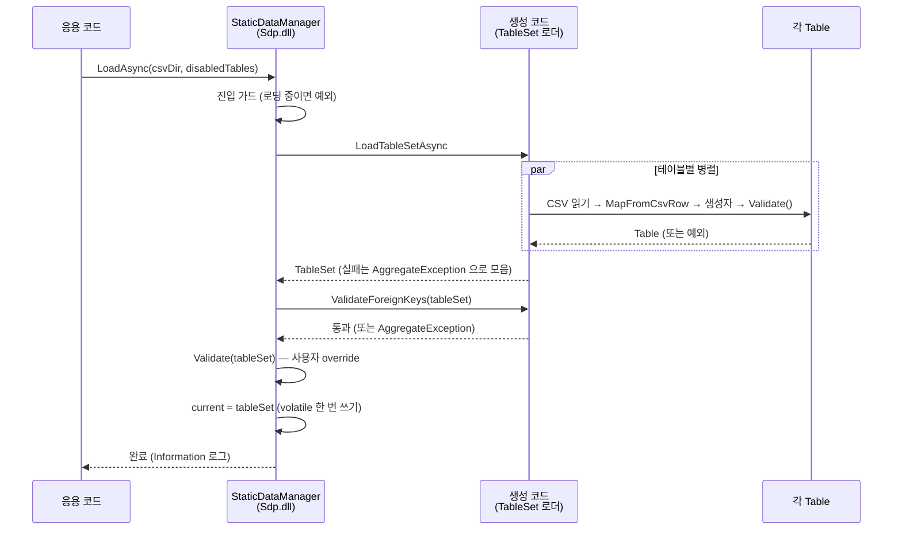

# 3.5 StaticDataManager 로 여러 테이블 관리

여러 테이블을 한 번에 로드하고 일관된 스냅샷으로 노출하려면 `StaticDataManager` 가 필요합니다. 이 장에서는 카테고리 테이블과 아이템 테이블 두 개를 묶어 StaticDataManager 로 돌려 봅니다. 테이블 사이의 FK 검증은 다음 챕터 [3.6 외래 키](./06-foreign-keys.md) 에서 다룹니다.

## 예제 도메인

아이템 상점을 약간 확장합니다. 카테고리 시트가 따로 있고, 아이템은 그 카테고리를 참조합니다 (참조 검증은 다음 챕터에서 다루므로 여기서는 단순한 두 테이블 로드까지만 봅니다).

```csharp
using Sdp.Attributes;

[StaticDataRecord("GameItems", "Categories")]
public sealed partial record CategoryRecord(
    int Id,
    string Name,
    bool IsConsumable);

[StaticDataRecord("GameItems", "Items")]
public sealed partial record ItemRecord(
    int Id,
    string Name,
    int CategoryId,
    int Price);
```

각각의 Table 클래스도 둡니다.

```csharp
using System.Collections.Immutable;
using Sdp.Table;

public sealed partial class CategoryTable(ImmutableArray<CategoryRecord> records)
    : StaticDataTable<CategoryRecord>(records);

public sealed partial class ItemTable(ImmutableArray<ItemRecord> records)
    : StaticDataTable<ItemRecord>(records);
```

</br></br></br>

## Manager 와 TableSet 정의

`StaticDataManager` 는 "어떤 테이블들을 다루는지" 를 `TableSet` 타입으로 선언받습니다. TableSet 은 **각 테이블을 파라미터로 받는 record** 입니다.

```csharp
using Microsoft.Extensions.Logging;
using Sdp.Manager;

public sealed partial class GameStaticData(ILogger<GameStaticData> logger)
    : StaticDataManager<GameStaticData.TableSet>(logger)
{
    public sealed partial record TableSet(
        CategoryTable? CategoryTable,
        ItemTable? ItemTable);
}
```

네 가지 규칙이 있습니다.

1. **TableSet record 의 파라미터 이름이 곧 TableSet 속성 이름** 이 된다. FK 가 도입되면 이 이름이 `[ForeignKey]` 의 첫 번째 인자와 일치해야 한다 ([3.6](./06-foreign-keys.md)).
2. **각 테이블은 nullable 로 선언한다.** 매 로드마다 모든 테이블이 들어 있을 거라 가정하지 않기 때문이다. 뒤에서 설명하는 `disabledTables` 옵션으로 일부 테이블을 건너뛰면 그 자리는 `null` 이 된다.
3. **`StaticDataManager<TTableSet>` 는 `ILogger` 를 생성자 인자로 요구한다.** 서브클래스에서 base 로 그대로 전달한다. 로드 진행 상황 (전체 완료, 테이블별 완료) 이 이 로거로 기록된다.
4. **Manager 와 TableSet 모두 `partial` 로 선언한다.** 소스 제너레이터가 TableSet 에는 로드와 FK 검증 코드를, Manager 에는 그것을 연결하는 코드를 생성한다. 빠뜨리면 빌드 시 `SDP0219` / `SDP0202` 오류가 난다.

추가로 **TableSet 은 주 생성자가 정확히 하나여야 한다.** 생성된 로드 코드가 그 생성자로 TableSet 을 조립하기 때문에, 없거나 둘 이상이면 빌드 시 `SDP0006` 오류가 난다. record 로 선언하면 자연스럽게 한 개가 된다. ViewSet 도 같은 규칙을 따른다 ([3.7](./07-static-data-view.md)).

StaticDataManager 는 **`Current` 한 곳만 외부에 노출** 합니다. StaticDataManager 안에서 `CategoryTable => Current.CategoryTable!` 처럼 테이블을 풀어 두면 호출부가 짧아지지만, **같은 작업 안에서 두 번 호출하면 서로 다른 스냅샷을 볼 수 있다** 는 함정이 생깁니다. 다음 절에서 자세히 봅니다.

</br></br></br>

## 로드와 조회

```csharp
var staticData = new GameStaticData(logger);
await staticData.LoadAsync("./csv");

var tables = staticData.Current;
foreach (var item in tables.ItemTable!.Records)
{
    Console.WriteLine($"{item.Id} {item.Name}");
}
```

`Current` 를 한 번 받아 변수에 담아 두는 점이 중요합니다. 호출부는 그 변수 안의 테이블들로만 일을 합니다. 왜 한 번만 받아야 하는지는 아래 [LoadAsync 의 동시성](#loadasync-의-동시성) 과 [일관된 스냅샷으로 조회하기](#일관된-스냅샷으로-조회하기) 에서 자세히 다룹니다.

TableSet 의 구조 — 주 생성자, 각 멤버가 `StaticDataTable` 인지, `[ForeignKey]` / `[SwitchForeignKey]` 의 타겟이 TableSet 과 Record 에 존재하는지 — 는 소스 제너레이터가 빌드 시점에 검사합니다. 그래서 `LoadAsync` 는 구조 검사 없이 바로 로드에 들어가며, 다음 순서로 동작합니다.

1. **TableSet 병렬 로드** — 생성된 로드 코드가 각 테이블의 CSV 를 병렬 로드. 각 테이블 인스턴스화 직후 `StaticDataTable.Validate()` 가 호출되며, 테이블별 로드 시간은 `Trace` 레벨로 기록. 하나라도 실패하면 모든 실패를 모아 `AggregateException(Messages.TablesFailedToLoad, ...)` 으로 throw.
2. **FK 값 검증** — 모두 성공하면 TableSet 을 조립하고, FK 가 있다면 실제 값 검증. 검증 실패가 있으면 `AggregateException(Messages.FkValidationFailed, ...)` 으로 throw.
3. **StaticDataManager 검증** — (override 했다면) StaticDataManager 의 `Validate(TTableSet)` 가 호출됨. 예외를 던지면 그대로 throw.
4. **스냅샷 교체** — 모두 통과하면 `StaticDataManager.Current` 에 한 번에 교체하고, 전체 로드 시간을 `Information` 레벨로 기록.

로드가 실패한 경우 `Current` 는 갱신되지 않고 직전 상태가 유지됩니다 (첫 로드 중이라면 아직 `null`).

누가 무엇을 하는지로 다시 그리면 다음과 같습니다. 진입 가드와 스냅샷 교체는 `Sdp.dll` 이, 테이블 로드와 FK 검증은 빌드 때 어셈블리에 들어간 생성 코드가, `Validate` 는 사용자가 override 한 코드가 맡습니다.



런타임에 필요한 입력은 CSV 폴더 하나뿐입니다. Excel, Record 소스, 추출기, 소스 제너레이터는 런타임에 존재하지 않습니다.

</br></br></br>

## 특정 테이블 건너뛰기

CI 에서 일부 테이블만 빠르게 검증하거나, 개발 서버에서 아직 준비되지 않은 테이블을 임시로 제외하고 싶을 때 `disabledTables` 를 씁니다.

```csharp
await staticData.LoadAsync("./csv", disabledTables: ["ItemTable"]);
```

- 파라미터 이름 기준으로 매칭합니다. `"ItemTable"` 은 TableSet 의 파라미터 `ItemTable` 에 대응합니다.
- 해당 테이블은 로드되지 않고 TableSet 속성에 `null` 이 들어갑니다. non-nullable 로 선언한 테이블을 disable 하면 `NonNullableTableDisabled` 로 로드가 실패합니다.
- 해당 테이블을 대상으로 한 FK 가 다른 테이블에 있다면 검증이 실패합니다 — 대상이 없는데 참조할 수 없기 때문입니다. 따라서 실제로는 서로 독립된 그룹 단위로만 disable 하는 것이 안전합니다.

각 테이블이 TableSet 에서 nullable 로 선언된 가장 큰 이유가 이 옵션의 존재입니다. `null` 가능성이 타입에 드러나 있어야 disable 된 자리를 읽지 않고 넘어가는 코드를 짤 수 있습니다.

실무에서는 **브레이킹 체인지를 임시로 우회하는 개발용 옵션** 으로 자주 쓰입니다. 어떤 테이블의 스키마가 깨졌지만 그 테이블을 사용하지 않는 코드를 먼저 빌드, 실행해 봐야 할 때 해당 테이블을 disable 해 두면 코드를 수정하지 않고도 진행할 수 있습니다. 호출부에서 disable 된 자리를 우회하는 별도 코드를 작성할 필요는 없지만, 필요하다면 nullable 가드로 분기를 둘 수도 있습니다.

</br></br></br>

## 로드 시간 측정

`StaticDataManager` 는 주입받은 `ILogger` 로 두 단계를 기록합니다.

- 테이블별 로드 완료 — `Trace` 레벨, 메시지 키 `LoadedTable` (`테이블 {Name} 로드 완료 ({ElapsedMs}ms)`).
- 전체 `LoadAsync` 완료 — `Information` 레벨, 메시지 키 `LoadAsyncCompleted` (`LoadAsync 완료 ({ElapsedMs}ms)`).

테이블별 시간을 따로 보고 싶다면 호스트 측에서 최소 로그 레벨을 `Trace` 로 낮춥니다. 정상 운영 로그를 깔끔하게 유지하려면 `Information` 으로 두면 전체 완료 시간만 남습니다.

</br></br></br>

## StaticDataManager 수준의 추가 검증

`StaticDataManager.Validate(TTableSet)` 를 override 하면 모든 FK 검증이 끝난 뒤 한 번 호출됩니다. 테이블 간 교차 제약 (예: "무기 카테고리의 아이템은 최소 한 개는 있어야 한다") 처럼 개별 테이블에서 표현하기 어려운 규칙을 여기에서 점검합니다. 앞에서 정의한 `GameStaticData` 안에 `Validate` 를 override 해 둡니다.

```csharp
public sealed partial class GameStaticData(ILogger<GameStaticData> logger)
    : StaticDataManager<GameStaticData.TableSet>(logger)
{
    public sealed partial record TableSet(
        CategoryTable? CategoryTable,
        ItemTable? ItemTable);

    protected override void Validate(TableSet tableSet)
    {
        // 여기에 테이블 간 교차 검증 로직을 작성
    }
}
```

</br></br></br>

## LoadAsync 의 동시성

`LoadAsync` 는 동시 진입을 가드합니다. 이미 로딩 중일 때 다른 스레드에서 호출하면 즉시 `InvalidOperationException` 으로 거부됩니다. 로딩이 끝난 뒤의 `Current` 교체는 `volatile` 필드 한 번의 쓰기로 이루어지므로, 조회 측이 부분 갱신된 중간 상태를 보는 일은 없습니다.

같은 이유로 **데이터를 다시 읽어 들이는 것도 `LoadAsync` 를 한 번 더 부르는 것** 이 전부입니다. 새 CSV 폴더 (또는 같은 폴더) 로 호출하면 위 순서를 처음부터 다시 거쳐 새 스냅샷으로 교체되고, 이미 `Current` 를 받아 둔 쪽은 옛 스냅샷을 끝까지 봅니다. 언제 다시 부를지 (운영 명령, 파일 변경 감지, 배포 훅 등) 는 Sdp 가 정하지 않으며 응용 측의 책임입니다.

</br></br></br>

## 일관된 스냅샷으로 조회하기

`Current` 는 호출할 때마다 그 시점의 `current` 필드 값을 반환합니다. 특히 **`LoadAsync` 가 백그라운드에서 다시 실행될 수 있는 환경** 이라면, 두 번 연속 `Current` 를 읽는 사이에 새 스냅샷으로 교체될 수 있습니다. 첫 로드 직후이거나 응용 측이 어떤 이유로 `LoadAsync` 를 다시 호출하는 흐름이라면, 호출 시점에 따라 스냅샷이 달라질 수 있습니다.

```csharp
// 위험 - 두 줄 사이에 LoadAsync 가 새 값을 세팅하면
// categoryTable 과 itemTable 이 서로 다른 버전을 본다
var categoryTable = staticData.Current.CategoryTable!;
var itemTable = staticData.Current.ItemTable!;
```

같은 작업에서 여러 테이블을 함께 다룰 때는 **`Current` 를 변수에 한 번만 받아 쓰는 것이 안전합니다.**

```csharp
// 안전 - 한 스냅샷에서 두 테이블을 함께 꺼낸다
var tables = staticData.Current;
var categoryTable = tables.CategoryTable!;
var itemTable = tables.ItemTable!;
```

StaticDataManager 에서 `CategoryTable` / `ItemTable` 같은 편의 프로퍼티를 풀어 두지 않는 이유가 여기에 있습니다. 풀어 두면 호출부가 두 번 접근할 때마다 매번 `Current` 를 다시 읽게 되어 같은 위험이 그대로 옮겨갑니다. **항상 `Current` 한 곳에서 한 번 받아 쓰는 패턴** 이 가장 단순합니다.

</br></br></br>

## ASP.NET Core 에서 DI 로 사용

요청 단위 수명이 있는 환경에서는 **Manager 는 Singleton, TableSet 스냅샷과 각 테이블을 Scoped** 로 등록하는 패턴을 권장합니다. 컨트롤러나 핸들러는 `GameStaticData` 전체가 아니라 필요한 테이블만 직접 주입받습니다.

```csharp
// Program.cs
services.AddSingleton<GameStaticData>();

// 한 요청 안에서 같은 TableSet 스냅샷을 공유하도록 묶는다
services.AddScoped<GameStaticData.TableSet>(sp =>
    sp.GetRequiredService<GameStaticData>().Current);

services.AddScoped<CategoryTable>(sp =>
    sp.GetRequiredService<GameStaticData.TableSet>().CategoryTable!);

services.AddScoped<ItemTable>(sp =>
    sp.GetRequiredService<GameStaticData.TableSet>().ItemTable!);
```

`TableSet` 자체를 Scoped 로 묶어 두면, 한 요청 안에서 등장하는 모든 테이블이 같은 스냅샷에서 풀어진 인스턴스가 됩니다. 요청 처리 중에 `LoadAsync` 가 새 스냅샷으로 교체되더라도, 이미 진행 중인 요청은 시작 시점의 스냅샷을 끝까지 봅니다. 앞 절에서 본 "두 줄 사이에 LoadAsync 가 끼어드는" 위험이 DI 구성 단계에서 차단됩니다.

```csharp
public sealed class ItemController(
    CategoryTable categoryTable,
    ItemTable itemTable) : ControllerBase
{
    [HttpGet("{id:int}")]
    public IActionResult Get(int id)
    {
        // categoryTable 과 itemTable 은 이 요청에 묶인 같은 스냅샷에서 풀어진 인스턴스
        ...
    }
}
```

`LoadAsync` 자체는 Manager 가 Singleton 이라 어디서든 같은 인스턴스에서 부르면 됩니다. 일반적으로 호스팅 시작 시 한 번 호출합니다.

</br></br></br>

## 이번 장까지의 정리

- Record 와 Excel 이 대응한다 (3.1, 3.3).
- Record 하나당 `StaticDataTable` 하나를 만든다 (3.4).
- 여러 테이블은 `StaticDataManager` 로 묶어 로드하고, `Current` 한 곳에서 일관된 스냅샷으로 꺼낸다 (3.5).

다음 챕터에서는 테이블 사이의 외래 키 검증을 다룹니다.

---

[← 이전: 3.4 StaticDataTable 구현](./04-static-data-table.md) | [목차](../README.md) | [다음: 3.6 외래 키 →](./06-foreign-keys.md)
