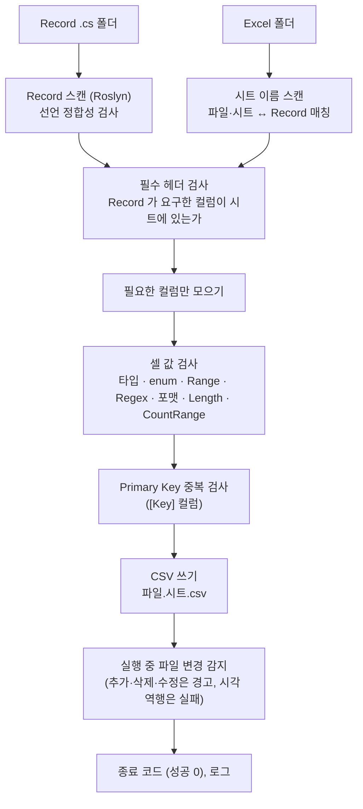

# 4.2 ExcelColumnExtractor

`ExcelColumnExtractor` 는 Excel 파일들과 C# Record 정의를 입력받아, 각 Record 가 요구하는 컬럼만 추려 CSV 로 내보내는 CLI 도구입니다. 빌드 단계에서 한 번 돌리고, Sdp 런타임은 그 CSV 만 읽습니다.

레코드 작업자 시점에서 추출기가 어디에서 등장하는지는 [3.3 첫 Record 정의하기](../03-usage/03-first-record.md#추출-실행하기) 에서, 데이터 작업자가 푸시 전에 직접 돌려 보는 방법은 [3.1 — 푸시 전에 직접 확인하기](../03-usage/01-record-to-excel.md#푸시-전에-직접-확인하기) 에서 다룹니다. 이 챕터는 도구 자체의 사용법 — 명령 형태, 옵션 전체, 출력 형식, bat 예제 — 에 집중합니다.

</br></br></br>

## 안에서 무슨 일이 일어나나

추출기는 네 자리 중 **빌드** 자리의 도구로, 두 작업자의 산출물 (Excel, Record `.cs`) 을 처음으로 한자리에 모읍니다. 한 번 실행하면 다음 단계를 차례로 거칩니다.



- 어느 단계에서든 실패하면 0 이 아닌 종료 코드로 끝나고, 어느 시트의 어느 컬럼, 어느 값이 문제인지 로그에 남깁니다. 검사 실패는 처리되지 않은 예외로 끝나므로 값은 환경마다 다르고 (Windows 에서는 보통 `0xE0434352`), 종료 코드 `1` 은 명령줄 인자가 잘못된 경우에만 나옵니다. CI 나 bat 에서는 특정 값 대신 0 인지 아닌지로 판단합니다.
- Excel 파일이 열려 있어 잠겨 있으면 사본을 떠서 읽습니다. 데이터 작업자가 작업 중에 돌려 봐도 됩니다.
- 실행 중에 `.cs` 나 Excel 파일이 추가·삭제·수정되면 마지막 단계에서 경고합니다. 단, 수정 시각이 실행 시작 시점보다 과거로 바뀐 파일이 있으면 실패합니다. 결과가 어느 시점의 파일을 반영한 것인지 보장하기 위한 장치입니다.
- 외래 키 값은 검사하지 않습니다. 시트 하나씩 처리하므로 다른 시트의 값을 알지 못합니다 ([3.6 — FK 오류를 머지 전에 잡으려면](../03-usage/06-foreign-keys.md#fk-오류를-머지-전에-잡으려면)).

</br></br></br>

## 명령 구조

`ExcelColumnExtractor` 는 단일 명령입니다. 서브 명령 (verb) 이 없습니다.

```bash
ExcelColumnExtractor.exe [옵션...]
```

필수 옵션 세 개로 입력 폴더, Excel 폴더, 출력 폴더를 지정합니다.

```bash
ExcelColumnExtractor.exe ^
  --record-path ./Records ^
  --excel-path ./Excels ^
  --output-path ./Csv
```

</br></br></br>

## 옵션

|옵션|의미|기본값|
|-|-|-|
|`-r`, `--record-path`|Record `.cs` 디렉터리 경로. 파일 경로를 주면 실행 직후 실패합니다|필수|
|`-e`, `--excel-path`|Excel 파일이 있는 디렉터리 경로|필수|
|`-o`, `--output-path`|CSV 출력 디렉터리 경로|필수|
|`-s`, `--start-cell`|헤더 시작 셀 주소 (예: `A1`, `B3`, `C7`). 열 문자는 대문자로 적습니다 — `b2` 처럼 소문자를 주면 헤더를 찾지 못해 실패합니다|`A1`|
|`-v`, `--version`|출력 버전 — 지정하면 `output-path/version` 하위 폴더에 산출|없음|
|`-f`, `--force`|`--version` 사용 시 해당 폴더에 파일이 이미 있어도 덮어씀|`false`|
|`-l`, `--log-path`|로그 디렉터리 경로 (그 아래 일자별 `log<날짜>.txt` 가 생성됨)|없음|
|`-m`, `--min-log-level`|최소 로그 레벨 (Verbose, Debug, Information, Warning, Error, Fatal)|Information|

`--record-path` 와 `--excel-path` 는 각 디렉터리 최상위의 `*.cs`, `*.xlsx` 만 읽습니다. 하위 폴더, `~$` 로 시작하는 Excel 임시 파일, `.xls` 파일은 읽지 않습니다.

</br></br></br>

## 출력 형식

추출 결과 CSV 는 **`{파일}.{시트}.csv`** 규칙으로 만들어집니다.

| Excel 파일 | 시트 | 출력 CSV |
|-|-|-|
| `GameItems.xlsx` | `Items` | `GameItems.Items.csv` |
| `Heroes.xlsx` | `BaseStats` | `Heroes.BaseStats.csv` |

CSV 의 헤더는 시트의 **원본 헤더** 를 그대로 유지합니다. Record 측에서 `[ColumnName("Cost")]` 로 다른 파라미터 이름에 매핑하더라도 CSV 에는 시트의 `Cost` 가 들어갑니다. 매핑은 로드 단계에서 처리됩니다.

Record 가 요구하지 않은 컬럼은 CSV 에 포함되지 않습니다. 같은 Excel 을 서버, 클라이언트, 툴이 각자 다른 Record 정의로 소비할 수 있는 이유가 여기에 있습니다.

CSV 의 컬럼 순서는 시트가 아니라 Record 선언 (평탄화한 헤더) 순서를 따릅니다. 시트에서 컬럼 순서를 바꿔도 같은 CSV 가 만들어집니다.

CSV 는 BOM 없는 UTF-8 로 저장됩니다. 쉼표, 따옴표, 줄바꿈이 든 셀은 헤더와 본문 모두 RFC 4180 규칙대로 따옴표로 감쌉니다.

</br></br></br>

## 헤더 시작 셀 (`--start-cell`)

`--start-cell` 은 각 시트에서 **헤더 첫 칸이 어디인지** 를 알려줍니다. 그 셀의 다음 행부터 데이터로 간주합니다.

|       | **A**             | **B**    | **C**     | **D**   | **E**        |
|-------|-------------------|----------|-----------|---------|--------------|
| **1** | 아이템 테이블       |          |           |         |              |
| **2** | 최종 수정 2026-05-15 |        |           |         |              |
| **3** | Id                | Name     | Memo      | Price   | Category     |
| **4** | 1                 | Potion   | 회복 아이템 | 100     | Consumable   |

위 시트는 `--start-cell A3` 으로 추출합니다. `1`, `2` 행은 자유 영역 (시트 제목, 변경 이력 등) 이라 무시됩니다.

데이터 행 중 Record 가 요구한 컬럼이 모두 비어 있는 행은 결과에서 제외됩니다. 데이터 사이에 빈 행을 두어도 되고, Record 가 요구하지 않은 컬럼 (위 예시의 `Memo`) 만 채운 행도 제외됩니다.

옵션을 생략하면 `A1` 에서 시작한다고 가정합니다. 한 프로젝트 안에서는 시작 셀을 하나로 합의해 두는 편이 단순합니다.

</br></br>

### Record 단위로 시작 셀 덮어쓰기

대부분의 시트는 같은 위치에서 시작하지만 일부 시트만 다른 위치에서 시작해야 한다면, `[StaticDataRecord]` 의 세 번째 인자에 시작 셀을 적습니다. 이 값이 있으면 `--start-cell` CLI 옵션보다 우선합니다 ([5.2 `[StaticDataRecord]`](../05-advanced/02-attributes.md#attr-staticdatarecord) 참고).

```csharp
// 프로젝트 기본은 B3 으로 합의되어 있지만, 이 시트만 A1 에서 시작
[StaticDataRecord("GameItems", "Quests", "A1")]
public sealed partial record QuestRecord(int Id, string Title);
```

CLI 호출은 한 줄로 통일해 두고, 예외만 attribute 로 표시하는 방식이 시트 수가 늘어났을 때 관리하기 편합니다.

</br></br></br>

## 버전 폴더 (`--version`, `--force`)

`--version` 을 지정하면 출력이 `output-path/<version>/` 하위 폴더에 모입니다. 빌드 번호나 데이터 패치 번호로 산출물을 분리해 두고 싶을 때 씁니다.

```bash
ExcelColumnExtractor.exe ^
  --record-path ./Records ^
  --excel-path ./Excels ^
  --output-path ./Csv ^
  --version 1.2.3
```

결과:

```
Csv/
└── 1.2.3/
    ├── GameItems.Items.csv
    ├── Heroes.BaseStats.csv
    └── ...
```

</br></br>

### 버전 문자열을 정할 때 주의할 점

같은 버전 폴더에 이미 파일이 있으면 추출은 **에러로 중단** 됩니다 (의도치 않은 덮어쓰기 방지). 따라서 버전 문자열은 **한 번 만들어지면 다시 같은 값이 나오지 않는 식별자** 여야 합니다.

날짜만 쓰는 식별자 (`2026-05-18`) 는 같은 날 여러 번 추출하는 흐름에서 매번 충돌하므로 적합하지 않습니다. 권장되는 식별자는 다음과 같습니다.

- **SemVer + 빌드 메타데이터** — `1.2.3-build.42`, `1.2.3+commit.a1b2c3d`
- **CI 빌드 번호** — `$(Build.BuildNumber)`, `${{ github.run_number }}` 등 CI 가 매 빌드마다 증가시키는 값
- **날짜 + 빌드 카운터** — `2026-05-18.42` (같은 날의 N 번째 빌드)
- **커밋 해시** — `a1b2c3d` (PR/머지 단위로 산출물을 보관할 때)

같은 버전 폴더에 의도적으로 다시 추출해야 한다면 (예: 디버깅 목적으로 같은 빌드를 재생성) `--force` 를 추가합니다.

```bash
ExcelColumnExtractor.exe ^
  --record-path ./Records ^
  --excel-path ./Excels ^
  --output-path ./Csv ^
  --version 1.2.3 ^
  --force
```

`--version` 을 지정하지 않으면 충돌 검사가 동작하지 않으므로 `--force` 도 의미가 없습니다 — 곧바로 `output-path` 에 산출하며 같은 이름의 파일은 그대로 덮어씁니다. 로컬 개발에서는 `--version` 없이 돌리고, CI/배포 산출물에서는 `--version` 으로 분리하는 식이 일반적입니다.

</br></br></br>

## 실행 예시

### 기본

```bash
ExcelColumnExtractor.exe ^
  --record-path ./Records ^
  --excel-path ./Excels ^
  --output-path ./Csv
```

### 시작 셀 합의가 `B3` 인 프로젝트

```bash
ExcelColumnExtractor.exe ^
  --record-path ./Records ^
  --excel-path ./Excels ^
  --output-path ./Csv ^
  --start-cell B3
```

### 빌드 버전별로 산출물 분리

```bash
ExcelColumnExtractor.exe ^
  --record-path ./Records ^
  --excel-path ./Excels ^
  --output-path ./Csv ^
  --start-cell B3 ^
  --version 1.2.3-build.42
```

### 로그를 파일로 남기며 상세하게

```bash
ExcelColumnExtractor.exe ^
  --record-path ./Records ^
  --excel-path ./Excels ^
  --output-path ./Csv ^
  --log-path ./Logs ^
  --min-log-level Debug
```

</br></br></br>

## bat 으로 묶어 두기

추출기는 빌드 단계에서 자주 호출되므로 bat 으로 묶어 두면 편합니다.

```bat
@echo off
ExcelColumnExtractor.exe ^
  --record-path .\Records ^
  --excel-path .\Excels ^
  --output-path .\Csv ^
  --start-cell B3
if errorlevel 1 (
  echo Extract failed.
  pause
  exit /b 1
)
echo Extract succeeded.
pause
```

추출 실패 시 종료 코드가 0 이 아니므로 `errorlevel` 로 분기할 수 있습니다.

같은 명령을 GitHub Actions 같은 CI 의 한 스텝으로 등록해 두면 빌드 과정에 그대로 통합됩니다. 추출 실패 시 종료 코드가 0 이 아니므로 그대로 워크플로우 실패로 이어져, 잘못된 데이터가 머지되기 전에 드러납니다.

</br></br></br>

## 권장 워크플로우

1. 한 프로젝트 안에서 `--start-cell` 위치를 하나로 합의합니다 (예: `B3` — `A` 열과 `1`, `2` 행은 시트 자유 영역).
2. 빌드 파이프라인에 추출기 호출을 한 단계로 둡니다.
3. 산출 CSV 는 런타임 빌드 출력 폴더로 복사되어 `StaticDataManager.LoadAsync` 가 읽습니다 ([3.5](../03-usage/05-static-data-manager.md) 참고).
4. 빌드 버전을 데이터에 기록해 두고 싶다면 `--version` 으로 출력 폴더를 분리합니다.

CI 스텝은 보통 다음 순서로 묶습니다. 로컬 bat 은 같은 명령을 `--version` 없이 돌리는 것으로 충분합니다.


- 추출이 앞에 오므로 Excel 쪽 결함 (헤더, 셀 값) 이 가장 먼저 드러납니다.
- `dotnet build` 는 Record 선언 결함을 `SDPxxxx` 로 멈춥니다.
- 로드 테스트는 추출기가 검사하지 않는 FK 값과 `Validate`, 뷰 빌드를 거릅니다 ([3.6](../03-usage/06-foreign-keys.md#fk-오류를-머지-전에-잡으려면)).
- 산출 CSV 를 저장소에 커밋하는 대신 빌드 번호별 아티팩트로 두면, 배포본이 어느 데이터 버전으로 만들어졌는지 `--version` 폴더 이름으로 추적할 수 있습니다.

추출 자체에서 거르는 검증은 다음 다섯 가지입니다.

- **Record 스키마 결함** — 추출기가 Roslyn 으로 `.cs` 파일을 파싱해 잘못된 Attribute 사용, 지원하지 않는 타입 등을 잡습니다 (IDE 빌드 시점이 아니라 추출기 실행 시점에 동작).
- **헤더 누락** — Record 가 요구한 컬럼이 시트에 없을 때. 표준 헤더가 없으면 `{헤더}.Value` 이름으로 한 번 더 찾고, 그렇게 찾은 컬럼은 CSV 헤더도 `Id.Value` 처럼 시트의 이름으로 나갑니다.
- **헤더 중복 참조** — Record 의 헤더 두 개가 시트의 같은 컬럼을 가리킬 때.
- **셀 값-타입 호환성** — `[Range]`, `[RegularExpression]`, `[DateTimeFormat]`, `[Length]`, `[CountRange]`, enum 멤버 등 셀 값이 Record 의 타입/Attribute 와 어긋날 때.
- **Primary Key 중복** — `[Key]` 가 붙은 컬럼의 시트 내 값 중복.

외래 키 (`[ForeignKey]`, `[SwitchForeignKey]`) 검증은 추출 단계가 아니라 런타임 (`LoadAsync`) 에서 일어납니다 ([3.6](../03-usage/06-foreign-keys.md) 참고).

---

[← 이전: 4.1 StaticDataHeaderGenerator](./01-header-generator.md) | [목차](../README.md) | [다음: 5.1 지원 타입 (Schemata) →](../05-advanced/01-schemata.md)
