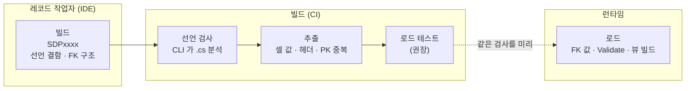

# 5.4 유효성 검사 개요

Sdp 의 유효성 검사가 파이프라인의 어느 시점에서 동작하는지 한 페이지로 정리합니다. 개별 Attribute 의 상세는 [5.2 Attribute 카탈로그](./02-attributes.md) 를, 데이터 흐름 전체는 [1. 소개](../01-introduction.md) 를 참고하세요.

## 네 가지 검사 시점

|시점|수행 주체|대상|
|-|-|-|
|**선언 검사**|`ExcelColumnExtractor` · `StaticDataHeaderGenerator`|Record/Attribute **선언** 자체의 결함|
|**빌드**|`Sdp.SourceGenerator` (컴파일 시점 진단 `SDPxxxx`)|Record/Table/TableSet/ViewSet **선언** 의 결함과 FK 선언의 구조|
|**추출**|`ExcelColumnExtractor`|Excel **셀 값** 이 스키마·Attribute 와 호환되는지|
|**로드**|`StaticDataManager.LoadAsync`|런타임 적재 시점의 값·참조 검사|

선언 검사와 추출은 빌드 파이프라인(오프라인)에서, 빌드 검사는 Record 를 포함한 프로젝트를 컴파일할 때, 로드는 애플리케이션 런타임에서 동작합니다. 선언 검사는 `.cs` 소스를 분석하므로 `ExcelColumnExtractor` 와 `StaticDataHeaderGenerator` 양쪽 실행 시 모두 수행됩니다. 아래 A·B 표의 항목 상당수는 빌드 시점에도 같은 내용이 진단으로 보고됩니다. 진단 전체 목록은 [5.6 진단 코드 목록](./06-diagnostics.md) 에 있습니다.

Sdp 가 쓰이는 네 자리 ([1. 소개](../01-introduction.md#네-자리에서-쓰인다)) 위에 올려 보면, 검사는 왼쪽에서 오른쪽으로 갈수록 더 늦게, 더 많은 입력을 보고 일어납니다. 어떤 결함이 어디서 처음 드러나는지가 이 그림에서 정해집니다.

FK 값, 사용자 `Validate`, 뷰 빌드는 **로드에서만** 검사됩니다. 이 셋을 머지 전에 걸러내고 싶다면 추출된 CSV 로 `LoadAsync` 를 한 번 돌리는 테스트를 CI 에 둡니다 ([3.6 — FK 오류를 머지 전에 잡으려면](../03-usage/06-foreign-keys.md#fk-오류를-머지-전에-잡으려면)).

   

## 검사 항목별 동작 시점

`O` 는 해당 시점에 검사함, `—` 는 검사하지 않음을 뜻합니다.

### A. 타입·구조 스키마

|검사 항목|선언 검사|추출|로드|비고|
|-|-|-|-|-|
|지원 타입 여부|O|—|—|미지원 타입 거부|
|컬렉션 자체 nullable 금지|O|—|—|`ImmutableArray<T>?`·`FrozenSet<T>?`·`FrozenDictionary<,>?`|
|Nullable Record 원소 금지|O|—|—|Record 배열/셋/Map Value 의 nullable|
|순환 참조 금지|O|—|—|Record 가 자기 자신을 직·간접 포함|
|Map Key non-nullable|O|—|—||
|Map Key↔Value `[Key]` 타입 일치|O|—|—||

### B. Attribute 정합성

|검사 항목|선언 검사|추출|로드|비고|
|-|-|-|-|-|
|`[Length]` 정합성|—|O|O|생략 가능. 있으면 추출·로드가 초과 인덱스를 거부하고, 없으면 시트/CSV 의 `이름[i]` 헤더 수가 길이|
|`[NullString]` 필수·오사용|O|—|—|nullable 필수, non-nullable 금지|
|`[DateTimeFormat]` 필수·오사용|O|—|—|`DateTime` 필수, 비-DateTime 금지|
|`[TimeSpanFormat]` 필수·오사용|O|—|—|`TimeSpan` 필수, 비-TimeSpan 금지|
|`[RegularExpression]` 타입|O|—|—|`string` / `string?` 전용|
|`[Range]` 적용 가능 타입|O|—|—|`bool`·컬렉션·record 금지|
|`[CountRange]` 정합성|O|—|—|`[SingleColumnCollection]` 필요, `[Length]` 배타, minCount ≥ 0 (빌드는 `SDP0007` / `SDP0005` / `SDP0019`)|
|`[SingleColumnCollection]` 정합성|O|—|—|Map 불가, 원소 primitive 만, `[Length]` 배타 (빌드는 `SDP0013`)|
|`[Key]` 정합성|O|—|—|Record 당 최대 1개·non-nullable 은 선언 검사 / Map Value 의 `[Key]` 존재는 선언 검사와 빌드 시 `SDP0017` — 로드는 Key 존재를 검사하지 않고 Map 키 중복만 검사|
|`[StaticDataRecord]` 존재|O|O|—|선언 검사 대상 식별 / 추출 대상 0개 시 종료 / 테이블의 Record 에 없으면 빌드 시 `SDP0215`|

### C. 셀 값

|검사 항목|선언 검사|추출|로드|비고|
|-|-|-|-|-|
|헤더 존재|—|O|O||
|같은 시트 컬럼을 가리키는 헤더 중복|—|O|—|두 파라미터에 같은 `[ColumnName]` 을 붙인 경우 등. 로드는 두 파라미터가 같은 컬럼을 함께 읽어 오류 없이 통과|
|셀 값-타입 호환성|—|O|O|로드는 생성된 매퍼의 타입별 `Parse` 실패로 검출|
|enum 멤버 이름 유효성|—|O|O|추출은 멤버 이름만 허용 (정수 값·대소문자 불일치 거부). 로드는 생성된 `switch` 로 멤버 이름을 매칭하고 정수 값 문자열(`1`)도 허용 — `[Key]` enum 은 쉼표로 조합한 값도 허용|
|`DateTime`/`TimeSpan` 포맷 일치|—|O|O|양쪽 동일 format 으로 `ParseExact`|
|`[Range]` 값 범위|—|O|O||
|`[RegularExpression]` 패턴 일치|—|O|O||
|`[CountRange]` 분할 원소 개수|—|O|O|단일 컬럼 컬렉션|
|Primary Key 시트 내 중복|—|O|—|`[Key]` 컬럼. 로드는 자동 검사 없음 — `UniqueIndex` 가 opt-in 으로 보장|

### D. 외래 키

|검사 항목|선언 검사|빌드|로드|비고|
|-|-|-|-|-|
|`[ForeignKey]`·`[SwitchForeignKey]` 동시 부착 금지|O|O|—|빌드는 `SDP0204`|
|`[SwitchForeignKey]` 중복 조건 금지|O|O|—|빌드는 `SDP0208` / `SDP0225`|
|FK 타겟 TableSet 존재|—|O|O|이름 오타는 빌드 시 `SDP0205`, `disabledTables` 로 빠진 테이블 참조는 검증할 값이 있을 때 로드 시 `FkTargetNotFound`|
|FK 타겟이 `[SingleColumnCollection]` 아님|—|O|—|`SDP0207`|
|FK 타겟 컬럼 존재|—|O|—|`SDP0206`|
|FK 참조 컬럼과 타겟 컬럼 타입 일치|—|O|—|`SDP0211`|
|`[SwitchForeignKey]` 조건 컬럼 존재|—|O|—|`SDP0209`|
|`[SwitchForeignKey]` 조건값 형식|—|O|—|`SDP0212`, `SDP0220` ~ `SDP0223`|
|`[SwitchForeignKey]` 조건값 분기 매칭|—|—|O|`SwitchFkConditionValueNotMatched`|
|FK 참조 값 존재|—|—|O|실제 참조 무결성 (`FkValueNotFound`)|

### E. 로드 구조

|검사 항목|선언 검사|빌드|로드|비고|
|-|-|-|-|-|
|Record·Table·Manager·TableSet·ViewSet·View 의 `partial`|—|O|—|`SDP0001`, `SDP0203`, `SDP0219`, `SDP0202`, `SDP0301`, `SDP0303`|
|TableSet 단일 주 생성자|—|O|—|`SDP0006`|
|테이블 파라미터 타입|—|O|—|`StaticDataTable<>` 여부, `SDP0213`|
|테이블 생성자(`ImmutableArray`) 존재|—|O|—|테이블에 생성자를 직접 선언하지 않으면 소스 제너레이터가 `ImmutableArray<TRecord>` 하나를 받는 생성자를 만들어 준다. 생성자를 직접 쓸 때는 `ImmutableArray<TRecord>` 하나를 받는 생성자가 있어야 하며, 없으면 생성 코드에서 컴파일 오류|
|ViewSet 단일 주 생성자|—|O|—|`SDP0006`|
|View 파라미터 타입·non-nullable|—|O|—|`SDP0305`, `SDP0302`|
|View 생성자(`TableSet`) 존재|—|O|—|`SDP0304`|
|View 의 TableSet 이 매니저의 TableSet 과 일치|—|O|—|`SDP0308`|
|non-nullable 테이블의 disable 금지|—|—|O|`NonNullableTableDisabled`|
|`LoadAsync` 동시 진입 금지|—|—|O||
|`UniqueIndex` 키 중복|—|—|O|테이블/뷰 생성 시, opt-in|

### F. 사용자 정의 검증

|검사 항목|선언 검사|추출|로드|비고|
|-|-|-|-|-|
|테이블 자기 검증|—|—|O|`StaticDataTable.Validate()` override, 테이블 인스턴스화 직후|
|매니저 교차 검증|—|—|O|`StaticDataManager.Validate(TTableSet)` override, 모든 FK 검증 후|
|뷰 자기 검증|—|—|O|`StaticDataView.Validate()` override, 뷰 빌드 직후|

   

## 추출을 거친 CSV 만 운영에 올린다

셀 값 검사(C) 중 `[Range]`·`[RegularExpression]`·`[CountRange]` 는 추출과 로드 양쪽에서 같은 규칙으로 동작합니다. 그러나 Primary Key 중복은 추출 단계에서만, 선언 정합성 검사(A·B)는 선언 검사와 빌드 시점에서만 수행되고 로드에서는 수행되지 않습니다. 추출 단계를 거치지 않은 CSV 를 런타임에 직접 넣으면 이런 검사가 빠지므로, 정상적인 파이프라인은 항상 추출기를 거친 CSV 만 운영에 올립니다.

---

[← 이전: 5.3 타입 브랜딩 패턴](./03-type-branding.md) | [목차](../README.md) | [다음: 5.5 소스 제너레이터 →](./05-source-generator.md)
