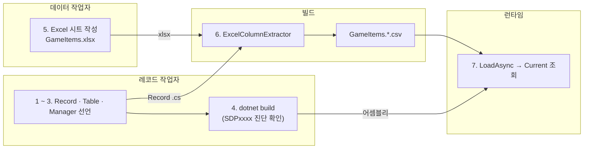

# 빠른 시작

Sdp 의 가장 기본적인 흐름을 한 페이지로 끝냅니다. **Record 를 선언하고 → 빌드하고 → Excel 을 채우고 → CSV 를 추출하고 → 로드해서 조회** 합니다. FK 와 뷰는 다루지 않습니다 (각 항목은 [상세 사용법](./README.md) 참고).

이 문서를 따라 끝내고 나면 다음을 갖추게 됩니다.

- 여러 시트를 한 번에 적재한 StaticDataManager 인스턴스
- ID 로 한 행을 조회할 수 있는 인덱스
- 추가 시트가 생기면 늘려 갈 수 있는 골격

설치는 [2. 설치](./02-installation.md) 를 따라 끝내 두었다고 가정합니다. `Sdp.dll` 과 `Sdp.SourceGenerator` 를 참조한 프로젝트 하나, 그리고 `ExcelColumnExtractor.exe` 가 필요합니다.

## 무엇을 어디서 하나

Sdp 는 네 자리에서 쓰입니다. 이 문서의 7단계가 각각 어느 자리에 속하는지 먼저 봐 두면 길을 잃지 않습니다.



|자리|하는 사람|이 문서의 단계|산출물|
|-|-|-|-|
|레코드 작업자|C# 개발자|1 ~ 4|Record · Table · Manager 선언, 빌드된 어셈블리|
|데이터 작업자|기획자 등 Excel 담당|5|`GameItems.xlsx`|
|빌드|CI 또는 로컬 bat|6|`GameItems.Items.csv` 등 CSV|
|런타임|애플리케이션|7|메모리에 올라간 `Current` 스냅샷|

1 ~ 4 와 5 는 서로를 기다리지 않습니다. 컬럼 이름만 합의되어 있으면 두 자리는 동시에 진행할 수 있고, 6 에서 처음 만납니다.

</br></br></br>

## 1. Record 정의 (레코드 작업자)

한 행의 모양과 어느 시트에서 오는지를 record + Attribute 로 적습니다.

```csharp
using Sdp.Attributes;

public enum ItemCategory
{
    Consumable,
    Weapon,
    Armor,
}

[StaticDataRecord("GameItems", "Items")]
public sealed partial record ItemRecord(
    int Id,
    string Name,
    [Range(0, 1_000_000)] int Price,
    ItemCategory Category);

[StaticDataRecord("GameItems", "Heroes")]
public sealed partial record HeroRecord(
    int Id,
    string Name,
    int Level);

[StaticDataRecord("GameItems", "Quests")]
public sealed partial record QuestRecord(
    int Id,
    [RegularExpression(@"^.{1,50}$")] string Title,
    int RewardItemId);
```

- `partial` — 소스 제너레이터가 같은 타입에 CSV 한 행을 Record 로 바꾸는 코드를 생성해 넣습니다. Record, Table, Manager, TableSet 모두 `partial` 로 선언합니다.
- `[StaticDataRecord("파일", "시트")]` — 첫 인자는 Excel 파일 이름 (확장자 제외), 두 번째 인자는 시트 이름. 파일과 시트 이름은 달라도 됩니다. 추출된 CSV 는 `{파일}.{시트}.csv` 규칙을 따라 `GameItems.Items.csv` 가 됩니다. **이 두 인자가 데이터 작업자와 합의해야 하는 전부입니다** — 파라미터 이름과 함께.
- 파라미터 이름이 곧 헤더 이름. enum 은 문자열로 매칭됩니다.
- `[Range(0, 1_000_000)]` — `Price` 값이 0 ~ 1,000,000 범위 안인지 검사합니다. 선언만 해 두면 추출 단계와 런타임 로드 양쪽에서 자동으로 검증되어, 범위를 벗어난 값은 별도 코드 없이 걸러집니다.
- `[RegularExpression(@"^.{1,50}$")]` — `Title` 이 1 ~ 50 자인지 정규식으로 검사합니다. 이 역시 선언만으로 추출과 로드 양쪽에서 검증됩니다.

</br></br></br>

## 2. Table 정의 (레코드 작업자)

`StaticDataTable<TRecord>` 를 상속하고 `ImmutableArray<TRecord>` 한 개짜리 생성자를 제공합니다. 소스 제너레이터가 CSV 로드 코드를 이 클래스에 생성하므로 `partial` 로 선언합니다. 키로 단일 레코드를 찾을 수 있도록 `UniqueIndex` 도 같이 둡니다.

```csharp
using System.Collections.Immutable;
using Sdp.Table;

public sealed partial class ItemTable : StaticDataTable<ItemRecord>
{
    private readonly UniqueIndex<ItemRecord, int> byId;

    public ItemTable(ImmutableArray<ItemRecord> records)
        : base(records)
    {
        byId = new UniqueIndex<ItemRecord, int>(records, x => x.Id);
    }

    public ItemRecord Get(int id) => byId.Get(id);

    public bool TryGet(int id, out ItemRecord? record) => byId.TryGet(id, out record);
}

public sealed partial class HeroTable(ImmutableArray<HeroRecord> records)
    : StaticDataTable<HeroRecord>(records);

public sealed partial class QuestTable(ImmutableArray<QuestRecord> records)
    : StaticDataTable<QuestRecord>(records);
```

`ItemTable` 처럼 `UniqueIndex` 를 둔 테이블만이 아니라, `HeroTable` · `QuestTable` 같이 인덱스 없는 테이블도 `Records` 속성으로 전체 목록을 그대로 노출합니다. `Records` 는 CSV 에 입력된 행 순서를 유지합니다.

</br></br></br>

## 3. Manager 와 TableSet (레코드 작업자)

Manager 는 "어떤 테이블들을 다루는지" 를 TableSet record 로 받습니다. TableSet 의 각 파라미터는 테이블 클래스의 인스턴스입니다. Manager 와 TableSet 모두 `partial` 로 선언합니다. 로드와 FK 검증 코드가 여기에 생성됩니다.

```csharp
using Microsoft.Extensions.Logging;
using Sdp.Manager;

public sealed partial class GameStaticData(ILogger<GameStaticData> logger)
    : StaticDataManager<GameStaticData.TableSet>(logger)
{
    public sealed partial record TableSet(
        ItemTable? ItemTable,
        HeroTable? HeroTable,
        QuestTable? QuestTable);
}
```

- TableSet 의 각 테이블은 nullable. 로드 옵션으로 일부를 건너뛸 수 있기 때문입니다 ([3.5](./03-usage/05-static-data-manager.md)).
- **외부 노출은 `Current` 한 곳만 한다.** 호출부에서는 `staticData.Current` 로 한 번 받아 두고 그 안에서 각 테이블을 꺼내 씁니다. StaticDataManager 에서 `ItemTable => Current.ItemTable!` 처럼 테이블을 풀어 두지 않는 이유는, 같은 작업 안에서 두 번의 `Current.X` 가 서로 다른 스냅샷을 보게 될 수 있기 때문입니다. 한 번에 받아 두면 그 스냅샷이 작업 끝까지 고정됩니다.

</br></br></br>

## 4. 빌드해서 진단 확인 (레코드 작업자)

여기까지 선언했으면 한 번 빌드합니다.

```bash
dotnet build
```

빌드가 통과하면 소스 제너레이터가 CSV 매핑, 테이블 로드, TableSet 조립 코드를 어셈블리 안에 넣어 둔 상태입니다. 직접 호출할 멤버는 없고, 7단계의 `LoadAsync` 가 안에서 씁니다.

빌드가 `SDPxxxx` 오류로 멈추면 선언에 결함이 있다는 뜻입니다. `partial` 누락, TableSet 주 생성자 개수, FK 타겟 오타가 흔한 원인이며 전체 목록은 [5.6 진단 코드 목록](./05-advanced/06-diagnostics.md) 에 있습니다. 이 단계는 Excel 이나 CSV 가 없어도 통과해야 합니다.

</br></br></br>

## 5. Excel 시트 작성 (데이터 작업자)

`GameItems.xlsx` 파일을 만들고 `Items`, `Heroes`, `Quests` 세 시트를 둡니다. 각 시트는 `A1` 부터 헤더 한 행, 그 아래로 데이터입니다. **헤더는 1단계 Record 의 파라미터 이름과 같습니다.**

`Items` 시트:

|       | **A**  | **B**    | **C**   | **D**        |
|-------|--------|----------|---------|--------------|
| **1** | Id     | Name     | Price   | Category     |
| **2** | 1      | Potion   | 100     | Consumable   |
| **3** | 2      | Sword    | 5000    | Weapon       |
| **4** | 3      | Shield   | 4000    | Armor        |

`Heroes` 시트:

|       | **A**  | **B**    | **C**   |
|-------|--------|----------|---------|
| **1** | Id     | Name     | Level   |
| **2** | 1      | Knight   | 10      |
| **3** | 2      | Archer   | 8       |

`Quests` 시트:

|       | **A**  | **B**           | **C**          |
|-------|--------|-----------------|----------------|
| **1** | Id     | Title           | RewardItemId   |
| **2** | 1      | First Steps     | 1              |
| **3** | 2      | Forge a Sword   | 2              |

- `Category` 는 enum 값 이름을 대소문자까지 그대로 적습니다 (`Consumable`, `Weapon`, `Armor`).
- Record 가 요구하지 않는 컬럼 (예: 메모) 은 시트에 자유롭게 더 둬도 됩니다. 추출 시 무시됩니다.
- 이 예제처럼 헤더가 짧으면 손으로 적어도 되지만, 객체 배열처럼 헤더가 `Subjects[0].Score` 식으로 길어지는 시트는 [3.2 표준 헤더 생성기](./03-usage/02-header-generator.md) 로 받아 붙여넣습니다.
- 1 ~ 4 단계가 아직 진행 중이어도 이 단계는 시작할 수 있습니다. 컬럼 이름만 맞으면 됩니다.

> Excel 없이 바로 돌려 보고 싶다면 6단계를 건너뛰고, 아래 6단계의 결과 CSV 세 개를 손으로 `./csv` 폴더에 써 두어도 됩니다. 실제 파이프라인에서는 항상 추출기를 거친 CSV 만 씁니다.

</br></br></br>

## 6. CSV 추출 (빌드)

`ExcelColumnExtractor` 에 Record `.cs` 폴더, Excel 폴더, 출력 폴더 세 곳을 알려 줍니다. 1단계의 `.cs` 가 `./Records` 에, 5단계의 `GameItems.xlsx` 가 `./Excels` 에 있다고 합시다.

```bash
ExcelColumnExtractor.exe ^
  --record-path ./Records ^
  --excel-path ./Excels ^
  --output-path ./csv
```

`./csv` 아래에 시트별 CSV 세 개가 만들어집니다. 파일 이름은 `{파일}.{시트}.csv` 규칙입니다.

```
csv/
├── GameItems.Items.csv
├── GameItems.Heroes.csv
└── GameItems.Quests.csv
```

`GameItems.Items.csv`:

```
Id,Name,Price,Category
1,Potion,100,Consumable
2,Sword,5000,Weapon
3,Shield,4000,Armor
```

추출기는 옮겨 적기만 하지 않고, Record 가 요구한 헤더가 시트에 있는지, 셀 값이 타입과 맞는지, `[Range]` / `[RegularExpression]` 을 지키는지, enum 이름이 맞는지를 함께 검사합니다. 어긋나면 0 이 아닌 종료 코드와 함께 어느 시트의 어느 컬럼인지 로그에 남깁니다. 이 명령을 CI 의 한 스텝으로 두면 잘못된 데이터가 머지되기 전에 드러납니다 ([4.2](./04-cli-tools/02-column-extractor.md)).

</br></br></br>

## 7. 로드와 조회 (런타임)

런타임에 필요한 것은 4단계의 어셈블리와 6단계의 CSV 폴더뿐입니다. Excel, Record 소스, 추출기는 필요 없습니다.

```csharp
var staticData = new GameStaticData(logger);
await staticData.LoadAsync("./csv");

var tables = staticData.Current;
var sword = tables.ItemTable!.Get(2);
Console.WriteLine($"{sword.Name}: {sword.Price}");
```

`LoadAsync` 는 CSV 디렉터리를 통째로 받아 TableSet 의 모든 테이블을 병렬 로드하고, FK 가 있다면 검증까지 끝낸 뒤 `Current` 에 한 번에 교체합니다. 다시 호출하면 새 스냅샷으로 atomic swap. 동시 조회 안전.

```csharp
// LoadAsync 가 백그라운드에서 실행될 수 있는 환경이라면 Current 를 변수에 받아 두고 사용한다
var tables = staticData.Current;
foreach (var quest in tables.QuestTable!.Records)
{
    Console.WriteLine($"{quest.Id} {quest.Title}");
}
```

</br></br></br>

## 끝났는지 확인하기

- [ ] `dotnet build` 가 `SDPxxxx` 오류 없이 통과한다 (4단계)
- [ ] `ExcelColumnExtractor` 가 종료 코드 0 으로 끝나고 `./csv` 에 CSV 세 개가 있다 (6단계)
- [ ] `LoadAsync` 가 예외 없이 끝나고 `tables.ItemTable!.Get(2)` 가 `Sword` 를 돌려준다 (7단계)

세 가지가 모두 통과하면 Sdp 의 골격이 완성된 것입니다. 시트가 늘어나면 Record 하나, Table 하나, TableSet 파라미터 하나를 추가하고 같은 흐름을 반복합니다.

</br></br></br>

## 다음 단계

여기서 익힌 7단계가 Sdp 사용의 80 % 입니다. 역할에 따라 이어 갈 챕터가 다릅니다.

- **데이터 작업자** — 시트를 어떤 모양으로 채우면 되는지, 긴 헤더는 어떻게 받는지: [3.1 Excel 작업하기](./03-usage/01-record-to-excel.md), [3.2 표준 헤더 생성기](./03-usage/02-header-generator.md)
- **레코드 작업자** — 이미 채워진 시트에 맞춰 Record 를 짜는 흐름과 추출기 실행: [3.3 첫 Record 정의하기](./03-usage/03-first-record.md). 테이블 사이의 참조 검증은 [3.6 외래 키](./03-usage/06-foreign-keys.md)
- **빌드·런타임 담당** — CI 스텝 구성은 [4.2](./04-cli-tools/02-column-extractor.md), 로드 순서와 DI 등록은 [3.5](./03-usage/05-static-data-manager.md)

---

[목차](./README.md)
