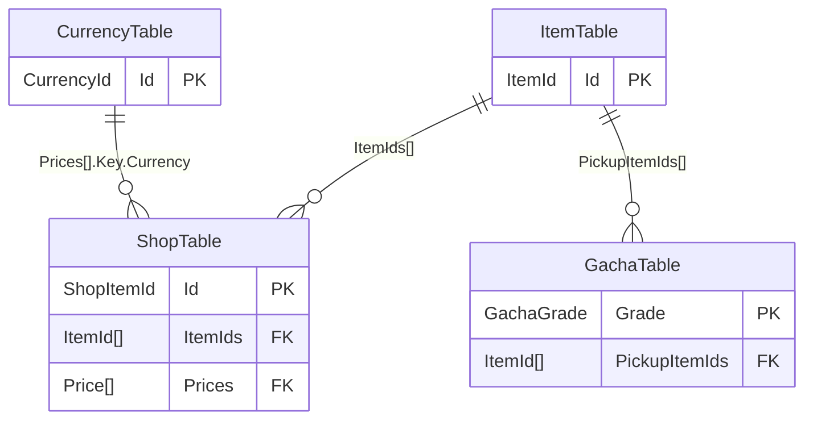
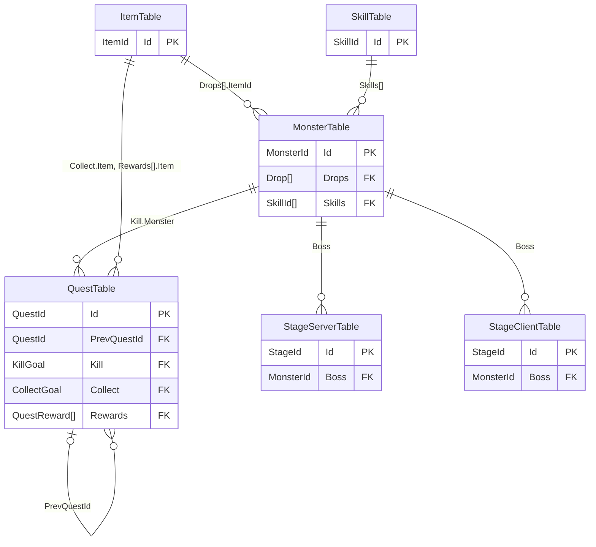
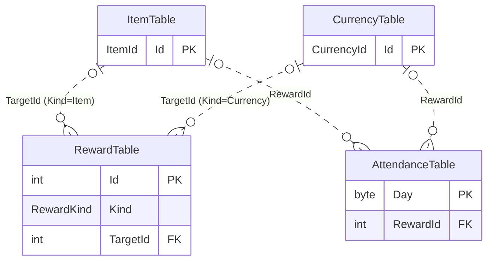
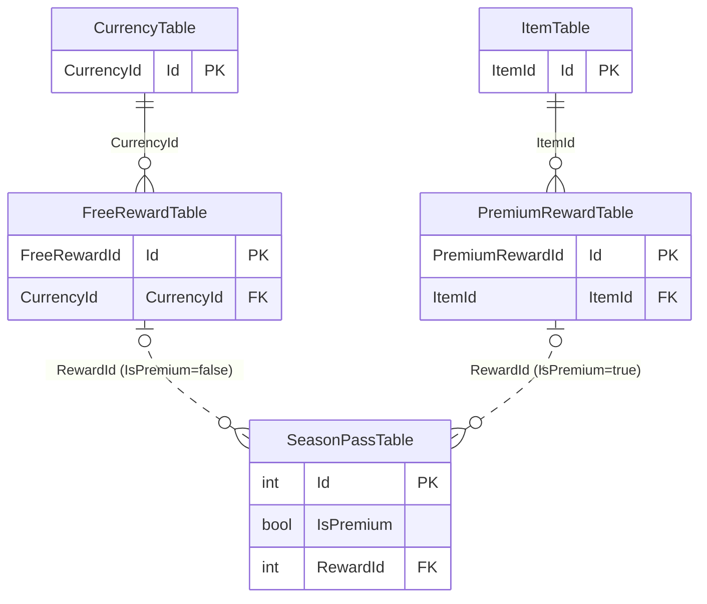
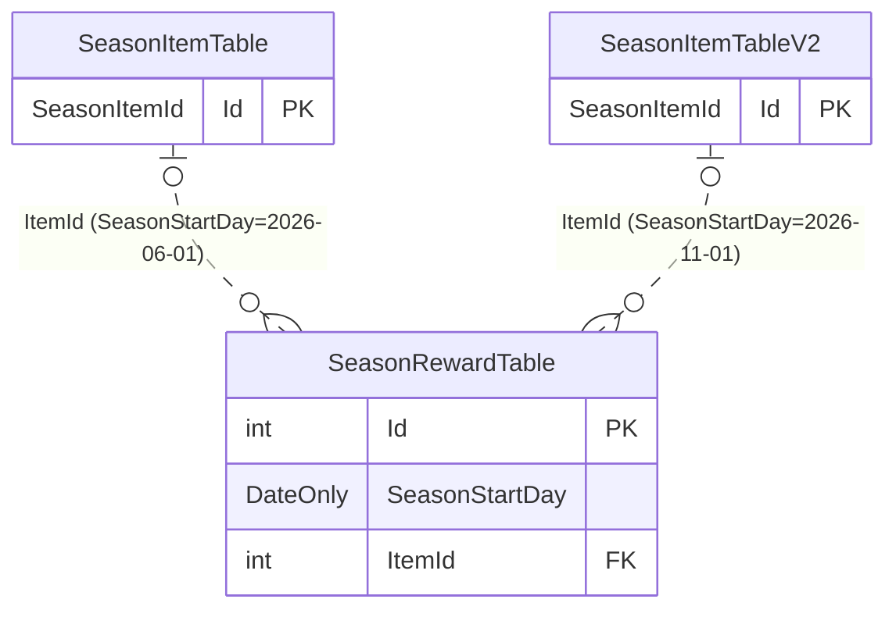

# Rpg 주제

시나리오 테스트가 쓰는 RPG 게임 예제다. 워크북 하나(`Excel/Rpg.xlsx`)의 시트 17개를 Record 18개가 읽어 테이블 19개를 만든다.

| 폴더 | 내용 |
|---|---|
| `Excel` | 정상 워크북 |
| `Records` | 시트의 열을 선언한 Record |
| `Tables` | Record 를 담는 테이블 |
| `Managers` | 테이블 묶음(`RpgStaticData.TableSet`) |
| `Golden` | 정상 워크북을 추출한 CSV 와 헤더 목록 |
| `Broken` | 한 군데씩 망가뜨린 워크북. 설명은 `Broken/README.md` |

## 테이블 관계

관계가 있는 테이블끼리 다섯 묶음으로 나눠 그렸다. `ItemTable` 과 `CurrencyTable` 은 여러 묶음에 나온다.

| 그림에서 | 뜻 |
|---|---|
| 선 | FK. 선의 글자는 FK 가 걸린 열이고, 선이 닿는 쪽 테이블의 `Id` 를 가리킨다 |
| 실선 | 항상 그 테이블을 가리킨다 |
| 점선 | 행마다 가리키는 테이블이 다르다 |
| 상자 안 | 키와 FK 열만 적었다. 나머지 열은 `Records` 의 선언에 있다 |

### 상점과 뽑기

아이템을 내주는 두 테이블이다. 상점은 재화를 받고 아이템을 주고, 뽑기는 등급마다 뽑히는 아이템을 정한다.

### 몬스터, 퀘스트, 스테이지

몬스터를 중심으로 묶인다. 퀘스트는 잡을 몬스터와 모을 아이템을, 스테이지는 보스를 가리킨다.

`QuestTable.PrevQuestId` 는 자기 테이블을 가리키고, 첫 퀘스트는 이 칸을 비워 둔다.

`StageServerTable` 과 `StageClientTable` 은 서로 가리키지 않는다. Stages 시트 하나를 서버와 클라이언트가 각자 필요한 열만 읽는다.

### 보상과 출석

한 열이 아이템을 가리킬 수도, 재화를 가리킬 수도 있는 두 테이블이다.

`RewardTable.TargetId` 는 `Kind` 가 Item 이면 `ItemTable`, Currency 면 `CurrencyTable` 을 가리킨다(`[SwitchForeignKey]`).

`AttendanceTable.RewardId` 는 둘 중 어느 쪽에든 있으면 된다(`[ForeignKey]` 두 개).

### 시즌 패스

`SeasonPassTable.RewardId` 는 `IsPremium` 이 false 면 무료 보상을, true 면 유료 보상을 가리킨다. 무료 보상은 재화를, 유료 보상은 아이템을 준다.

### 시즌 보상

`SeasonRewardTable.ItemId` 는 시즌 시작일에 따라 옛 시즌 아이템이나 새 시즌 아이템을 가리킨다.

`SeasonItemTable` 은 OldSeasonItems 시트를, `SeasonItemTableV2` 는 SeasonItems 시트를 읽는다.

### 관계가 없는 테이블

`BuffTable` 과 `DebuffTable` 은 FK 가 없고 다른 테이블도 이 둘을 가리키지 않는다. Buffs 시트 하나를 `IsDebuff` 값으로 나눠 만든 두 테이블이다.
