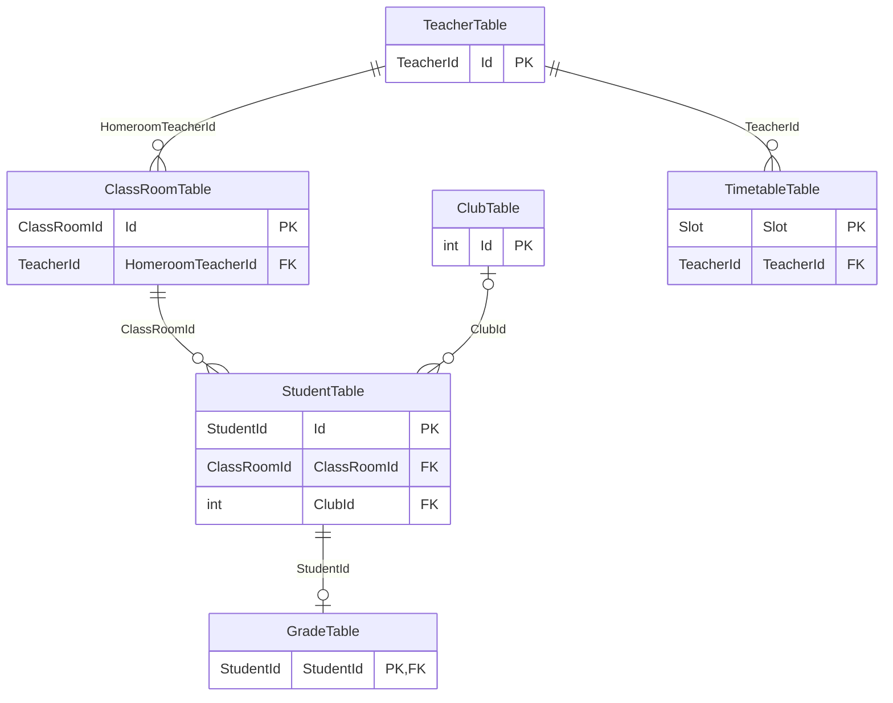
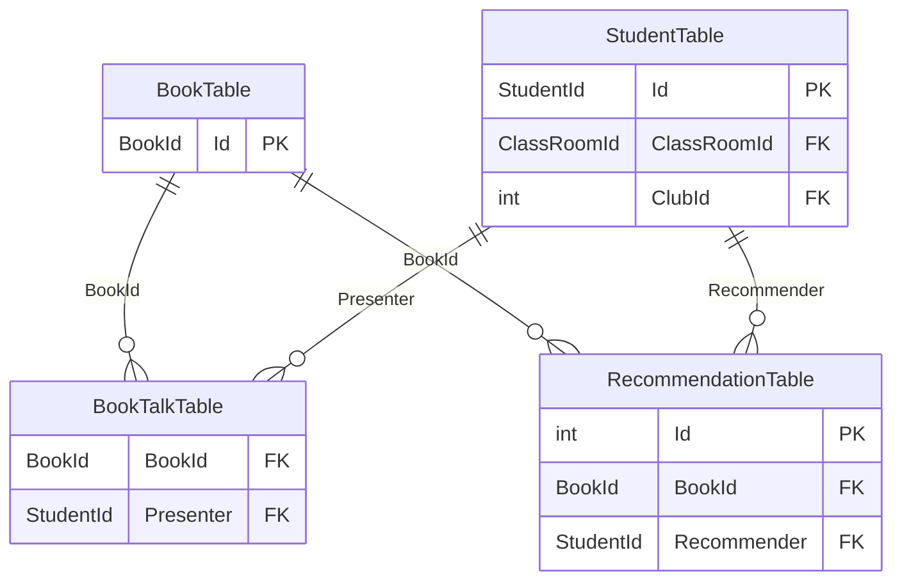

# School 주제

시나리오 테스트가 쓰는 학교 예제다. 워크북 둘(`Excel/School.xlsx`, `Excel/Library.xlsx`)의 시트 11개를 Record 11개가 읽어 테이블 11개를 만들고, 그 위에 뷰 2개를 만든다.

| 폴더 | 내용 |
|---|---|
| `Excel` | 정상 워크북. School 은 시트 8개, Library 는 시트 3개 |
| `Records` | 시트의 열을 선언한 Record. enum 과 중첩 record 는 `SchoolTypes.cs` |
| `Tables` | Record 를 담는 테이블 |
| `Views` | 여러 테이블을 묶어 만든 뷰 |
| `Managers` | 테이블 묶음과 뷰 묶음(`SchoolStaticData.TableSet`, `ViewSet`) |
| `Golden` | 정상 워크북을 추출한 CSV 와 헤더 목록 |
| `Broken` | 한 군데씩 망가뜨린 워크북. 설명은 `Broken/README.md` |

## 테이블 관계

관계가 있는 테이블끼리 두 묶음으로 나눠 그렸다. `StudentTable` 은 두 묶음에 모두 나온다.

| 그림에서 | 뜻 |
|---|---|
| 선 | FK. 선의 글자는 FK 가 걸린 열이고, 선이 닿는 쪽 테이블의 `Id` 를 가리킨다 |
| 상자 안 | 키와 FK 열만 적었다. 나머지 열은 `Records` 의 선언에 있다 |

### 교사, 교실, 학생

학생은 반에 속하고 반에는 담임 교사가 있다. 성적은 학생마다 하나이고 없을 수도 있다.

`StudentTable.ClubId` 는 동아리에 들지 않은 학생이면 비워 둔다.

`GradeTable` 은 키인 `StudentId` 가 곧 FK 다.

`TimetableTable` 의 키 `Slot` 에는 반 번호(`Slot.ClassRoomId`)가 들어 있지만 FK 를 걸지 않아 선이 없다.

### 도서관

Library 워크북의 세 테이블이다. 독서 토론 모임의 `Presenter` 와 추천 도서의 `Recommender` 는 다른 워크북(School)의 학생을 가리킨다.

`BookTalkTable` 에는 키가 없다. 같은 학생이 같은 책으로 여러 번 발제할 수 있어 같은 책과 학생의 행이 또 나올 수 있다.

### 관계가 없는 테이블

`CalendarTable`(학사 일정)과 `CafeteriaTable`(급식)은 FK 가 없고 다른 테이블도 이 둘을 가리키지 않는다.

## 뷰

| 뷰 | 묶는 테이블 | 내용 |
|---|---|---|
| `ReportCardView` | `StudentTable`, `ClassRoomTable`, `GradeTable` | 학생마다 학생, 반, 성적을 한데 묶은 성적표. 성적이 없는 학생은 성적이 null 이다 |
| `TeacherScheduleView` | `TeacherTable`, `TimetableTable` | 교사마다 맡은 수업 목록. 수업이 하나도 없는 교사가 있으면 로드가 실패한다 |
